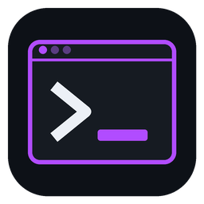

# ARES Terminal Console

Split-pane terminals with broadcast, keep-alive and a connection history. One
codebase, three ways to run it: a **desktop application** for Linux, macOS and
Windows, a **Docker image** you open in a browser, and a module of the
ApexBuild suite.

*Formerly Apex Terminal. 2.0.0 is the rename, plus the desktop and Docker
builds; a 1.x history folder is moved across on first start.*

## Install

| | |
| --- | --- |
| **Linux** | `ares-terminal-console_<v>_amd64.deb` (Debian, Ubuntu), `ares-terminal-console-<v>-1-x86_64.pkg.tar.zst` (Arch, `pacman -U`), or the `.tar.gz` with a per-user `./install.sh` that needs no root |
| **macOS** (Apple silicon) | `ares-terminal-console-<v>-macos-arm64.dmg` — drag to Applications. Unsigned for now: the first launch is right-click → Open |
| **Windows** | `ares-terminal-console-<v>-windows-x86_64-setup.exe` (no administrator rights needed), or the portable `.zip` |
| **Docker** | `docker run -d -p 8080:8080 -v ares-terminal:/data docker.cybercontrol.tech/ares/terminal-console` |

Releases are published, signed, to **ARES Repository**
(<https://aresrepo.cybercontrol.tech>). They are not attached to the GitHub or
GitLab release pages: the signed manifest on the repository is what proves a
download is genuine, and a second copy would be a second thing to keep in step.

### From source

```sh
./run.sh                # then open the URL it prints
./run.sh --port 9001
```

Python 3.11+ and **nothing else** — no pip install, no build step. A terminal is
what you reach for when a machine is already in a bad way, and "install this
first" is the wrong answer at that moment.

There is exactly one optional dependency, `claude-agent-sdk`, and it buys one
optional feature: the [ask bar](#asking-about-a-command). Everything above
still holds without it — the import is lazy, and a missing SDK costs you the
question box and nothing else.

## What it does

**Splits, like tmux.** `Ctrl+Shift+D` puts a pane beside the focused one,
`Ctrl+Shift+E` puts one below it. The layout is a binary tree, so closing a pane
collapses its parent back into its sibling instead of leaving a hole. Drag any
divider to re-balance.

**Broadcast.** Turn it on and every keystroke goes to every pane at once —
tmux's `synchronize-panes`. The chrome turns amber and stays amber, because
forgetting it is on is how you run a command on nine machines you meant to run
on one. The **send to all** bar next to it is the deliberate one-shot: type a
line, press Enter, it lands in every pane.

**Sessions outlive their socket.** Close the tab, lose wifi, suspend the laptop
— the command keeps running. Reopening replays the scrollback and carries on.
That is the property people actually want from tmux, and it is why the
**Running** tab lets you attach a session that no pane is currently showing.

**Keep-alive, at both ends.** The server pings every idle socket every 20
seconds, which is what stops a proxy or a power manager deciding the connection
is dead. That only covers the *browser* link, so there is a second control:
**anti-idle** writes a NUL byte to any session that has gone quiet for the
interval you pick. Shells discard it; the far end sees traffic and does not time
you out. It is off by default and the pane says so while it is on — it is still
a write into somebody's shell.

**Colour, without touching your shell config.** A listing is monochrome unless
two things are true, and in a plain shell neither is: `LS_COLORS` has to say
what each kind of file looks like, and `ls` has to be *asked* to colour with
`--color=auto`, which normally comes from an alias you may not have. Both are
set up for every pane — a palette matched to the suite's theme, and `ls`/`ll`/
`la`/`lt` wrappers placed first on `PATH`. Wrappers rather than aliases because
an alias would have to be injected into bash, zsh and fish separately, and
editing somebody's rc files to get colour is not a trade worth making. Your own
alias still wins, since aliases resolve before `PATH`. The **Colours** tab in
the drawer is the legend, rendered with the real escape sequences.

One honest limit: **GNU `ls` cannot colour hidden files.** Its scheme takes
two-letter type codes and `*suffix` patterns only — a leading-dot glob is
rejected outright. `eza` does accept one, so where it is installed `ll` and
`la` dim dotfiles; plain `ls` cannot, and no scheme changes that.

**History.** Everything opened here is recorded with when it started, when it
ended and how. Name one and it moves to **Saved**. Passwords are blanked before
anything reaches the disk — `--password`, `--token`, `sshpass -p`, credentials
in URLs — while `ssh -p 2222` keeps its port, because redacting that would hand
back a command that no longer connects.

## Server tools

A pane running `ssh …` gets a **◈ server** button (or `Ctrl+Shift+X`). It opens
seven tools for the machine on the other end, brought over from ARES Ultimate
Console and TractorBeam:

| | |
| --- | --- |
| ♥ **Health & processes** | CPU, memory, disk, load and network, refreshed every 5 s, with the top processes and a two-click Stop |
| ⚡ **Performance analysis** | a quick, standard or long sampled check: findings, charts and tables, saying what is slow and why |
| ☰ **Log analysis** | errors and warnings from the journal and syslog, grouped and counted |
| ✦ **AI log analysis** | those lines explained by Claude: verdict, likely cause, the first command to run |
| ▤ **Packages & technologies** | installed packages and the runtimes, servers and databases they add up to |
| ⛨ **Vulnerability scan** | pending security updates, server issues, and known CVEs looked up on OSV.dev |
| ↺ **Server history** | every scan and analysis of this machine, kept across sessions |

**Nothing is installed on the server, and nothing is changed.** Each tool is a
read-only shell script fed to `sh -s` over SSH. Panes started with `ssh` are
given OpenSSH multiplexing (`ControlMaster=auto`, a socket under
`~/.ssh/ares-tc/`), so the tools ride the login you already typed — a password,
a one-time code or a hardware key is asked for once, in the pane, and never by
a tool. A command that sets its own ControlMaster/ControlPath keeps it. Windows'
OpenSSH cannot multiplex, so there the tools need a key or an agent.

**A server is recognised by what it is, not what it is called.** History is
keyed on the machine's identity (`/etc/machine-id` and friends, or its SSH host
key fingerprint when nothing else is readable), so the same box reached by name,
by IP or through a jump host has one history.

**AI only with consent.** Before anything goes to Claude the tool shows *exactly*
what will be sent — secrets already replaced with `***`, no address, no server
identity — and sends that and nothing more when you press **Send to Claude**.
The answer goes through your Claude Code subscription, is saved to the server's
history, and its usage appears in the ask bar's cost ledger. The OSV.dev lookup
is the same: the package list is shown before it leaves the machine.

## Keys

| | |
| --- | --- |
| `Ctrl+Shift+Enter` | new pane |
| `Ctrl+Shift+D` / `E` | split vertical / horizontal |
| `Ctrl+Shift+W` | close the focused pane |
| `Ctrl+Shift+S` | broadcast on/off |
| `Ctrl+Shift+H` | connections drawer |
| `Ctrl+Shift+A` | ask bar on/off |
| `Ctrl+Shift+X` | server tools for the focused SSH pane |

`Ctrl+Shift+…` rather than a tmux prefix key: a prefix has to be intercepted
before the terminal sees it, and stealing a keystroke is how you break the one
program the user needed it for.

## Asking about a command

The **ask** bar under the panes (`Ctrl+Shift+A`) puts a question to Claude
through the [Claude Agent SDK][sdk] and answers with the command, plus a line
on what it does and what to watch for.

```
ask  how do I find what is listening on port 8443?

  ss -ltnp 'sport = :8443'                                    INSERT
  sudo lsof -iTCP:8443 -sTCP:LISTEN -n -P                     INSERT

  $0.0121  ·  908 in / 181 out  ·  3.0s  ·  claude-opus-5
```

**It never runs anything.** The agent is handed no tools and no permission to
use any, so there is no path from a sentence somebody typed to a command this
machine executes. `INSERT` puts the command at the prompt of the focused pane
*without a newline*: you read it, edit it if you want, and press Enter
yourself. Broadcast is deliberately ignored here — one click means one pane.

That is the whole design argument. A terminal is the one application where
"just run it for me" is least appropriate, because the operator is usually here
precisely to see the command before it runs, often on a machine that is already
in a bad way.

### Your Claude subscription

The assistant runs on the **Claude Code you already use, signed in with your
Claude subscription** (Pro, Max, Team or Enterprise). There is no key to paste
into this app: the SDK drives your `claude` CLI, and the CLI signs the request
with its own login. The ask bar shows the plan it is using (say, *Claude Max*);
hover it to see the account.

- **Not signed in?** The bar says so and offers **Sign in with Claude**, which
  opens a pane running `claude auth login`. Finish there, press **Check
  again**.
- **Claude Code not installed?** Install it from
  <https://claude.com/claude-code>. It is found on `PATH` and in its usual
  install folders, which matters for a desktop app started from a menu with a
  short `PATH`; `CLAUDE_CODE_PATH` points at it anywhere else.
- **An `ANTHROPIC_API_KEY` in your environment** would normally outrank the
  subscription and bill per token. Here it is masked from the assistant (not
  from your panes), so asks go through the subscription. To use the key
  instead, start the app with `ARES_ASK_AUTH=api-key`.

### What it costs

The `$` button opens a cost panel: total, per day, per model, and the recent
asks with their tokens, from the SDK's own accounting
(`ResultMessage.total_cost_usd` and its per-model breakdown). Through a
subscription nothing is billed per token, so those amounts are labelled
*included in subscription* and shown as what the ask would cost at API rates:
a measure of usage, not a bill. With `ARES_ASK_AUTH=api-key` they are what was
billed. A row is marked *estimated* only when the SDK reported no cost at all.

Questions are stored so a cost can be attributed to one; answers are not. The
ledger lives beside the history, in the data directory, and `Clear the ledger`
empties it.

### The one dependency

`claude-agent-sdk` is the only thing in `requirements.txt`, it is optional, and
it is imported lazily. The desktop app includes it; from source,
`pip install claude-agent-sdk` (under ApexBuild, `apex setup terminal` does
that in the module's own `.venv`). Without it the bar says so and everything else works unchanged —
a terminal has to open on a machine with no SDK, no Node and no network, which
is generally why you reach for one.

[sdk]: https://code.claude.com/docs/en/agent-sdk

## Where it runs

**Linux and macOS** use the standard library's `pty`. **Windows** uses ConPTY
through `pywinpty`, which the Windows desktop build carries; the default shell
there is PowerShell (`pwsh` when installed). Run from source on Windows without
`pip install pywinpty` and the app starts, serves its UI and says why it cannot
open a shell rather than pretending. The `ls`/`ll`/`la` colour wrappers are
POSIX shell scripts and are not installed on Windows.

## The desktop application

The installed app runs the server on `127.0.0.1` on a free port and shows it in
a window of its own: WebView2 on Windows, WKWebView on macOS, and on Linux an
app window of Chrome, Chromium, Brave or Edge (the default browser if none is
installed). Closing that window quits the app and ends its sessions, as closing
a terminal emulator does. Starting it again while it runs opens another window
onto the same sessions instead of a second server.

Its data lives in `~/.local/share/ares-terminal-console` (Linux),
`~/Library/Application Support/ARES Terminal Console` (macOS) or
`%APPDATA%\ARES Terminal Console` (Windows). `--self-test` starts it on a
temporary folder, proves a shell runs, and exits; every release build must pass
it. Building: see [`packaging/`](packaging) and *Releasing* below.

The desktop app includes the assistant's SDK but not the 200 MB copy of the
Claude Code CLI that ships inside it: it uses the Claude Code you installed and
signed in to, so there is one login and one thing to keep up to date. See
[Your Claude subscription](#your-claude-subscription).

## Docker

```sh
docker run -d --name ares-terminal -p 8080:8080 -v ares-terminal:/data \
    docker.cybercontrol.tech/ares/terminal-console:latest
docker logs ares-terminal       # the link, with its access token
```

The shells run **inside the container**, as the unprivileged user `ares`, with
bash, ssh, git, curl, dig, ping, jq, rsync and vim. What a pane can reach is
what the container can reach, so give it the network and the mounts you mean it
to have. Set `ARES_ACCESS_TOKEN` to choose the token, otherwise one is generated
and kept in `/data/access-token`.

## Scope, stated plainly

On loopback, run from source or under ApexBuild, it has **no authentication of
its own** — anything that can reach the port can open a shell as you. That is
the same trust boundary as every other tool in the suite, and the reason the
WebSocket checks `Origin` (browsers do not apply CORS to WebSocket handshakes,
so without that check any page on the internet could open one).

Anywhere else it requires an **access token**. Listening beyond loopback (the
Docker image, or `--host 0.0.0.0`) turns it on by itself, and the desktop app
always uses one, because every other user of a shared machine can reach a
loopback port too. The token travels once in the link (`?token=…`), is swapped
for an HttpOnly, SameSite=Strict cookie and redirected out of the address bar;
`/api/health` is the one path that answers without it. A token is a shared
secret, not a login: over anything but a private network, put TLS in front
(`https://` origins are accepted on the WebSocket for exactly that).

## Part of ApexBuild

Two files make it a module, and neither changes how it behaves on its own:

| File | What it is |
| --- | --- |
| `apexmodule.toml` | how the suite lists it: name, icon, health path |
| `apexmod` | the uniform launcher: `info`, `check`, `run --host --port` |

```sh
apex modules add /path/to/ares-terminal-console --link
apex app
```

The module id stays `terminal`, and `apexmodule.toml`, `apexmod` and the
`APEX_SSO_*` sign-on variables keep their names: they are ApexBuild's contract
with every module, not part of this app's brand.

Under the suite it is framed by the shell on a sibling loopback port, so it
names that one origin in `frame-ancestors` and nothing else. Standalone it
refuses framing entirely. See `docs/EMBEDDING.md` in the ApexBuild repository.

## Layout

```
ares-terminal-console/
├── apexmodule.toml      manifest, and the one place the version lives
├── apexmod              launcher (info / check / run)
├── run.sh, run.ps1      standalone entry points
├── Dockerfile           the browser-served image
├── packaging/           desktop builds, installers, icons, release scripts
└── app/
    ├── server.py        HTTP, WebSocket upgrade, JSON API, the access token
    ├── desktop.py       the desktop window, one server per user, --self-test
    ├── websocket.py     RFC 6455 framing, and the keep-alive ping
    ├── pty_session.py   PTYs (ConPTY on Windows), scrollback, the session registry
    ├── remote.py        an SSH pane's target, multiplexing, running probes over it
    ├── insight/         the server tools: probes, analysis, history (service.py)
    ├── history.py       history, saved connections, redaction
    ├── shell_env.py     the colour scheme and the ls/ll/la wrappers
    └── static/          the UI (xterm.js vendored, no CDN)
```

## Releasing

PyInstaller does not cross-compile, so each platform builds on its own kind of
machine. The version is `version` in `apexmodule.toml`; add its entry to
`CHANGELOG.md` (the release notes are read from there), commit, then:

```sh
packaging/build-linux.sh           # .tar.gz and .deb, in a Debian 11 container (old glibc)
packaging/build-arch.sh            # .pkg.tar.zst from that tarball (needs makepkg)
packaging/build-remote.sh          # Windows .exe/.zip and macOS .dmg/.zip, on the build hosts
packaging/release.sh --dry-run     # what would be published
packaging/release.sh               # sign and publish to ARES Repository
packaging/docker/docker-push.sh    # build, check and push the Docker image
```

`release.sh` reads its token and signing key from
`~/.config/ares-repository/ares-terminal-console.env`; neither is ever in this
repository.

## License

[MIT](LICENSE). The vendored xterm.js under `app/static/vendor/` is MIT as well,
under its own copyright.
