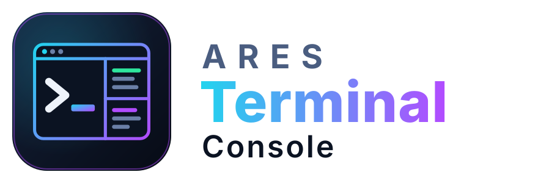

<p align="center"></p>

# ARES Terminal Console: Application Description

Version 2.3.0 · 16 November 2026 · Authored by Alfredo Nacino · Part of the ARES Application Suite

| Where | Address |
|---|---|
| **Downloads (signed)** | https://aresrepo.cybercontrol.tech |
| **Docker image** | `docker.cybercontrol.tech/ares/terminal-console` |
| **Listed on** | https://ares-suite.nacino.net |

Related documents: [Executive Summary](EXECUTIVE-SUMMARY.md) · [Executive Presentation](EXECUTIVE-PRESENTATION.md) · [Architecture](ARCHITECTURE.md) and its drawn [blueprint](blueprint.html) · [Application Description](DESCRIPTION.md).

ARES Terminal Console is a terminal with split panes and tabs, broadcast,
sessions that survive a closed window, a record of every connection and
command, seven read-only server tools, and an AI assistant that suggests
commands but never runs them. It runs as a desktop application on Linux,
macOS and Windows, as a Docker image used from a browser, and as the
`terminal` module of ApexBuild. It was formerly called Apex Terminal.

## Contents

1. [Installing](#installing)
2. [Panes and tabs](#panes-and-tabs)
3. [Broadcast](#broadcast)
4. [Sessions and keep-alive](#sessions-and-keep-alive)
5. [Where every pane is](#where-every-pane-is)
6. [History, commands and servers](#history-commands-and-servers)
7. [Colour](#colour)
8. [Server tools](#server-tools)
9. [The assistant](#the-assistant)
10. [Keyboard shortcuts](#keyboard-shortcuts)
11. [Platforms](#platforms)
12. [Security](#security)
13. [Configuration](#configuration)
14. [Releasing](#releasing)
15. [ARES Application Suite](#ares-application-suite)
16. [Version history](#version-history)

## Installing

| | |
|---|---|
| **Linux** | `ares-terminal-console_<v>_amd64.deb` (Debian, Ubuntu), `ares-terminal-console-<v>-1-x86_64.pkg.tar.zst` (Arch, `pacman -U`), or the `.tar.gz` with a per-user `./install.sh` that needs no root |
| **macOS** (Apple silicon) | `ares-terminal-console-<v>-macos-arm64.dmg`, drag to Applications. Unsigned for now: the first launch is right-click → Open |
| **Windows** | `ares-terminal-console-<v>-windows-x86_64-setup.exe` (no administrator rights needed), or the portable `.zip` |
| **Docker** | `docker run -d -p 8080:8080 -v ares-terminal:/data docker.cybercontrol.tech/ares/terminal-console` |

Downloads are on **ARES Repository**, <https://aresrepo.cybercontrol.tech>,
signed. They are not attached to GitHub or GitLab releases.

**From source:** `./run.sh` (or `run.ps1`), then open the URL it prints;
`--port 9001` picks the port. It needs Python 3.11 or newer and nothing else.
`pip install claude-agent-sdk` adds the assistant; `pip install pywinpty` is
needed on Windows.

## Panes and tabs

- `Ctrl+Shift+D` puts a pane beside the focused one, `Ctrl+Shift+E` below it.
  The layout is a binary tree: closing a pane gives its space back to its
  sibling. Drag any divider to re-balance.
- A connection opened from the drawer or with **⇄ connect…** gets its own tab
  with its own splits. **+** opens a tab with a local shell; **+ Pane** splits
  inside the tab on screen.
- Background tabs keep running. Double-click a tab to rename it. Closing a tab
  with live terminals takes a second click.
- The layout is remembered: a reload comes back to the same tabs and splits.

## Broadcast

- **Broadcast** (`Ctrl+Shift+S`) sends every keystroke to every pane in the tab
  on screen, like tmux's `synchronize-panes`.
- While it is on, the window chrome is amber and stays amber.
- **Send to all** is the deliberate one-shot: type a line, press Enter, and it
  lands in every pane of the tab.

## Sessions and keep-alive

- Closing the tab, losing wifi or suspending the laptop does not stop a
  command. Reopening replays the last 256 KB of output and continues.
- The **Running** tab lists sessions and attaches one no pane is showing.
- The server pings every idle connection to the window every 20 seconds.
- **Anti-idle** (off by default) writes a NUL byte to a session that has been
  quiet for the chosen interval, so the far end does not time it out. Shells
  discard it. The pane shows when it is on.

## Where every pane is

Each pane's bar shows the host, its IP address and the current directory,
kept up to date. For a local pane this comes from the terminal's foreground
process; for an SSH pane it is asked of the server over the pane's own
connection, with nothing to set up there. A shell that reports its directory
itself (OSC 7) is believed first. Click the directory to copy it.

## History, commands and servers

The connections drawer (`Ctrl+Shift+H`) has these tabs:

| Tab | What it lists |
|---|---|
| **History** | every session opened, with start, end and exit code; name one to keep it under **Saved** |
| **Saved** | named connections, for the ones used every day |
| **Commands** | every command line sent to a pane, with time, pane and server; searchable, with **Insert** (put it back on a prompt, unsent) and **Copy** |
| **Servers** | every SSH destination: connection count, first and last time, each session's start and length, commands sent, what the server tools know; **Connect** reopens it in a new tab |
| **Running** | live sessions |
| **Colours** | the `ls` colour legend, drawn with the real escape sequences |

**⌘** on a pane (`Ctrl+Shift+L`) lists the commands sent to that pane.

A command is read off the screen when Enter is pressed, so it is what the
shell actually received after tab-completion and history recall.

**What is never stored.** Input the terminal did not echo (passwords) is not
recorded. `--password`, `--token`, `sshpass -p`, credentials in URLs and
similar are blanked before anything is written. `ssh -p 2222` keeps its port,
because removing it would leave a command that no longer connects.

## Colour

A plain shell shows `ls` in monochrome, because `LS_COLORS` is empty and `ls`
needs `--color=auto`. Every pane gets both: a palette matched to the ARES theme
and `ls`/`ll`/`la`/`lt` wrappers first on PATH. These are wrappers rather than
aliases, so no rc file is edited; your own alias still wins.

GNU `ls` cannot colour hidden files (its scheme does not accept a leading-dot
pattern). Where `eza` is installed, `ll` and `la` dim dotfiles.

The wrappers are POSIX scripts and are not installed on Windows.

## Server tools

A pane running `ssh …` has a **◈ server** button (`Ctrl+Shift+X`). Any other
pane has **◈ system**, which runs the same tools on this computer. When an
`ssh` is typed into a local pane, the button becomes **◈ server** for as long
as that login lasts, and returns to **◈ system** after `exit`.

| Tool | What it does |
|---|---|
| ♥ **Health & processes** | CPU, memory, disk, load and network every 5 s, top processes, two-click Stop |
| ⚡ **Performance analysis** | quick, standard or long sampled check; findings, charts and tables saying what is slow and why |
| ☰ **Log analysis** | errors and warnings from the journal and syslog, grouped and counted |
| ✦ **AI log analysis** | those lines explained by Claude: verdict, likely cause, first command to run |
| ▤ **Packages & technologies** | installed packages, and the runtimes, servers and databases they add up to |
| ⛨ **Vulnerability scan** | pending security updates, server issues, and known CVEs from OSV.dev |
| ↺ **Server history** | every scan and analysis of this machine, kept across sessions |

**Nothing installed, nothing changed.** Each tool is a read-only shell script
run with `sh -s` over SSH. Panes started with `ssh` are given OpenSSH
connection sharing (`ControlMaster=auto`, socket under `~/.ssh/ares-tc/`), so
the tools use the login already typed: a password, one-time code or hardware
key is asked for once, in the pane. Local panes get an `ssh` wrapper that adds
the same sharing for interactive logins only. A command that sets its own
ControlMaster or ControlPath keeps it. Windows' OpenSSH cannot share
connections, so there the tools need a key or an agent.

**Identity.** History is keyed on the machine's identity (`/etc/machine-id` and
equivalents, or its SSH host key fingerprint), so one server reached by name,
by IP or through a jump host has one history.

**Consent.** Before anything goes to Claude, the tool shows exactly what will
be sent, with secrets replaced by `***` and no address or server identity, and
sends only that when you press **Send to Claude**. The OSV.dev lookup shows the
package list first in the same way. The Stop on a local system refuses the
app's own process.

The tools and their AI prompts come from ARES Ultimate Console and TractorBeam,
so both products diagnose a server the same way.

## The assistant

The **ask** bar under the panes (`Ctrl+Shift+A`) sends a question to Claude
and shows the command, a line on what it does and what to watch for.

```
ask  how do I find what is listening on port 8443?

  ss -ltnp 'sport = :8443'                                    INSERT
  sudo lsof -iTCP:8443 -sTCP:LISTEN -n -P                     INSERT
```

- **It never runs anything.** The agent has no tools and no permission to use
  any. **INSERT** puts the command at the focused pane's prompt without a
  newline; you read it, edit it, and press Enter. Broadcast is ignored here.
- **Your Claude subscription.** It runs on the Claude Code you installed and
  signed in to (Pro, Max, Team or Enterprise); the bar shows the plan. Not
  signed in: **Sign in with Claude** opens a pane running `claude auth login`,
  then **Check again**. Not installed: get it from
  <https://claude.com/claude-code>; `CLAUDE_CODE_PATH` points at a copy in an
  unusual place.
- **API keys.** An `ANTHROPIC_API_KEY` in the environment is hidden from the
  assistant (not from your panes) so asks use the subscription. Start with
  `ARES_ASK_AUTH=api-key` to use the key instead.
- **Cost.** The **$** panel shows totals per day and per model and the recent
  asks with their tokens, from the SDK's own accounting. Under a subscription
  they are labelled *included in subscription* and shown at API rates as a
  measure of usage. Questions are stored with their cost; answers are not.
  **Clear the ledger** empties it.
- **Optional.** Without `claude-agent-sdk` the bar says so and everything else
  works. The desktop app includes the SDK but not a second copy of the Claude
  Code CLI.

## Keyboard shortcuts

| Keys | Action |
|---|---|
| `Ctrl+Shift+Enter` | new pane |
| `Ctrl+Shift+D` / `E` | split vertical / horizontal |
| `Ctrl+Shift+W` | close the focused pane |
| `Ctrl+Shift+S` | broadcast on/off |
| `Ctrl+Shift+H` | connections drawer |
| `Ctrl+Shift+A` | ask bar on/off |
| `Ctrl+Shift+X` | server tools for the focused pane |
| `Ctrl+Shift+T` | new tab |
| `Ctrl+PageUp` / `PageDown` | previous / next tab |
| `Ctrl+Shift+L` | commands sent to the focused pane |
| `F11` | full screen (Linux desktop) |

`Ctrl+Shift+…` is used instead of a tmux-style prefix key, because a prefix
has to be taken before the terminal sees it, which breaks programs that need
that key.

## Platforms

| | Terminal | Window | Default shell |
|---|---|---|---|
| **Linux** | POSIX `pty` | native Qt window (PySide6 + Qt WebEngine, bundled) | `$SHELL` |
| **macOS** | POSIX `pty` | WKWebView | `$SHELL` |
| **Windows** | ConPTY (`pywinpty`) | WebView2 | `pwsh`, else PowerShell |
| **Docker** | POSIX `pty` in the container | your browser | bash, as user `ares` |

Run from source without PySide6, Linux falls back to a Chrome, Chromium, Brave
or Edge app window, then the default browser; `ARES_WINDOW=browser` asks for
that on purpose. Links to other sites open in the default browser.

Closing the window quits the app and ends its sessions, as with any terminal
emulator. Starting it again while it runs opens another window onto the same
sessions.

**Data folder:** `~/.local/share/ares-terminal-console` (Linux),
`~/Library/Application Support/ARES Terminal Console` (macOS),
`%APPDATA%\ARES Terminal Console` (Windows), `/data` (Docker).

## Security

- **Loopback, from source or under ApexBuild:** no login of its own; anything
  that can reach the port can open a shell as you. This is the same trust
  boundary as every other ApexBuild tool. Under ApexBuild the suite signs the
  user in with a one-time ticket.
- **Access token:** required by the desktop app always, and by any listener
  beyond loopback (the Docker image, `--host 0.0.0.0`). It is passed once in
  the link (`?token=…`), exchanged for an HttpOnly, SameSite=Strict cookie and
  removed from the address bar. `/api/health` is the only path answered
  without it.
- **TLS:** a token is a shared secret, not a login. Outside a private network,
  put TLS in front; `https://` origins are accepted on the WebSocket for that.
- **Origin check:** the WebSocket handshake checks `Origin`, because browsers
  do not apply CORS to WebSockets.
- **Framing:** standalone, only the app itself may frame it; under ApexBuild,
  the one suite origin is added.
- **Docker:** shells run inside the container as an unprivileged user. Give
  it only the network and mounts you mean it to have.

## Configuration

| Setting | Effect |
|---|---|
| `--port`, `--host` | where the server listens (from source) |
| `ARES_ACCESS_TOKEN` | choose the token (Docker); otherwise one is generated and kept in `/data/access-token` |
| `ARES_WINDOW=browser` | use a browser window instead of the native one |
| `ARES_ASK_AUTH=api-key` | the assistant uses `ANTHROPIC_API_KEY` instead of the subscription |
| `CLAUDE_CODE_PATH` | where the `claude` CLI is, if not on PATH or its usual folders |
| `--self-test` | start on a temporary data folder, prove a shell runs, exit |

## Releasing

The version is `version` in `apexmodule.toml`. Add its entry to
`CHANGELOG.md`, commit, then:

```sh
packaging/build-linux.sh           # .tar.gz and .deb, Debian 11 container
packaging/build-arch.sh            # .pkg.tar.zst
packaging/build-remote.sh          # Windows and macOS on the build hosts
packaging/release.sh --dry-run     # what would be published
packaging/release.sh               # sign and publish to ARES Repository
packaging/docker/docker-push.sh    # build, check and push the Docker image
packaging/register-ares-suite.sh   # update the ARES Application Suite entry and documents
```

## ARES Application Suite

ARES Terminal Console is listed on the ARES Application Suite
(<https://ares-suite.nacino.net>) under the integration key
`ares-terminal-console`, with its four documents:

| Suite slot | File uploaded | Built from |
|---|---|---|
| Executive summary | `ares-terminal-console-executive-summary.pdf` | `docs/EXECUTIVE-SUMMARY.md` |
| Executive presentation | `ares-terminal-console-executive-presentation.pptx` (PowerPoint) | `packaging/docs/presentation.js`, the same slides as `docs/executive-presentation.html` |
| Architecture | `ares-terminal-console-architecture-and-blueprint.pdf` | `docs/ARCHITECTURE.md` + `docs/blueprint.html` |
| Complete description | `ares-terminal-console-description.pdf` | `docs/DESCRIPTION.md` |

`packaging/build-docs.sh` builds all of them into `dist/docs/`, plus a PDF of the slides.

`packaging/register-ares-suite.sh` creates or updates the entry and uploads
the documents through the suite's integration API. It needs an integration
token from the suite's **Admin → Integrations** tab:

```sh
ARES_SUITE_TOKEN=asx_… packaging/register-ares-suite.sh
```

The token can also be kept in `~/.config/ares-suite/token`. `ARES_SUITE_URL`
selects another suite (for example the demo). It is safe to re-run: the entry
is matched by its key and each document replaces the one in its slot. Run it
after each release so the version and documents stay current.

## Version history

See [`CHANGELOG.md`](../CHANGELOG.md). In short:

| Version | Highlights |
|---|---|
| 2.3.0 | Linux desktop app in a native Qt window |
| 2.2.2 | server tools follow an `ssh` typed into a local pane |
| 2.2.1 | server tools on local panes (◈ system) |
| 2.2.0 | seven server tools, tabs, pane location, command record, Servers tab |
| 2.1.0 | assistant on the Claude subscription, MIT licence |
| 2.0.0 | renamed from Apex Terminal; desktop apps, Windows ConPTY, Docker image, access token |
