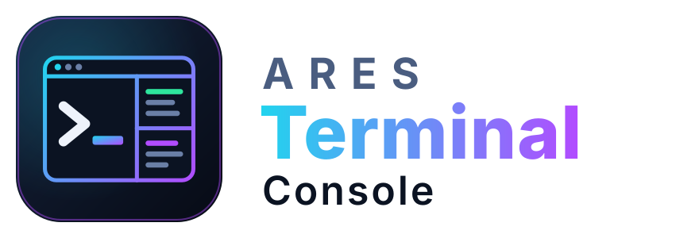

# ARES Terminal Console: Executive Presentation

Version 2.3.0 · 16 November 2026 · Authored by Alfredo Nacino · Part of the ARES Application Suite

| Where | Address |
|---|---|
| **Downloads (signed)** | https://aresrepo.cybercontrol.tech |
| **Docker image** | `docker.cybercontrol.tech/ares/terminal-console` |
| **Listed on** | https://ares-suite.nacino.net |

12 slides with speaker notes. The rendered deck is `docs/executive-presentation.html` (print to PDF at 16:9), and the PowerPoint file `ares-terminal-console-executive-presentation.pptx` is built from the same slides by `packaging/build-docs.sh`; the PowerPoint is what the ARES Suite holds.

---

## Slide 1 — ARES Terminal Console at a glance

- The terminal for the people who run our servers: **split panes and tabs**, like tmux
- **Broadcast**, **sessions that survive** a closed window, and a **record** of every connection and command
- **Seven server tools** on any SSH pane, from ARES Ultimate Console and TractorBeam
- An **AI assistant that suggests commands but never runs them**
- Desktop app for Linux, macOS and Windows; Docker image; ApexBuild module

**Speaker notes.** This is the tool an engineer has open all day. The point
is not another terminal emulator: it is a terminal that remembers what was
done, helps diagnose a server without leaving the pane, and is careful about
the two things that cause outages, running the wrong command and running it
on the wrong machine.

---

## Slide 2 — The problem

- Server work happens in plain terminals: nothing records what was run, or where
- Diagnosing a server means copying scripts across or opening other tools
- Running a change on several servers is done by hand, one at a time, or with a risky shortcut
- AI tools that "just run it" are the wrong fit for production machines

**Speaker notes.** Ask the room how they would find out what was run on a
server last Tuesday, and from whose laptop. Today the honest answer is shell
history, if it was not cleared. And every diagnosis starts with "let me get
the script over there".

---

## Slide 3 — Panes, tabs and broadcast

- `Ctrl+Shift+D` / `E` splits; closing a pane closes the gap
- One tab per connection, each with its own splits; the layout survives a reload
- **Broadcast** sends every keystroke to every pane in the tab; the screen is **amber** while it is on
- **Send to all** is the deliberate one-shot: type a line, press Enter, it lands everywhere

**Speaker notes.** Broadcast is powerful and dangerous. The amber is not
decoration: forgetting it is on is how a command meant for one machine runs on
nine. It is limited to the tab on screen for the same reason.

---

## Slide 4 — Nothing is lost

- Sessions keep running when the window closes, wifi drops or the laptop sleeps
- Reopening replays the scrollback and carries on
- Keep-alive at both ends: a ping every 20 s to the window, optional **anti-idle** to the server
- Every pane shows its host, IP address and current directory

**Speaker notes.** This is the property people actually want from tmux, with
nothing to learn. The pane bar answers "which machine am I on?" before every
command, which is the question that prevents most mistakes.

---

## Slide 5 — The record

- **Commands:** every command line sent, with time, pane and server, searchable, **Insert** to reuse
- **Servers:** every SSH destination, with sessions, durations and commands sent
- **History:** every connection opened; name one to keep it under **Saved**
- **Passwords are never written down**: unechoed input is skipped and `--password`-style secrets are blanked

**Speaker notes.** The command is read off the screen when Enter is pressed,
so it is what the shell actually received after tab-completion and history
recall, not the raw keys. `ssh -p 2222` keeps its port: redaction removes
secrets, not information needed to reconnect.

---

## Slide 6 — Server tools

- ♥ Health & processes · ⚡ Performance analysis · ☰ Log analysis · ✦ AI log analysis
- ▤ Packages & technologies · ⛨ Vulnerability scan (OSV.dev) · ↺ Server history
- **◈ server** on SSH panes, **◈ system** for this computer, `Ctrl+Shift+X`
- Follows an `ssh` typed into a local pane, and returns after `exit`

**Speaker notes.** These are the same diagnostics ARES Ultimate Console runs,
with the same AI prompts word for word, so both products reach the same
conclusions about a server. The difference is that here they are one click from
the pane where the problem is being looked at.

---

## Slide 7 — Nothing installed, nothing changed

- Each tool is a **read-only** shell script sent over SSH and run with `sh -s`
- It rides the pane's own login (OpenSSH connection sharing): a password or one-time code is typed **once**
- A server is recognised by its **machine identity**, so the same box by name, IP or jump host has one history
- The one action, Stop on a process, takes two clicks and refuses the app's own process

**Speaker notes.** No agent to install, no port to open, no second
credential. That is what lets it be used on servers we do not own or cannot
change.

---

## Slide 8 — The assistant

- Ask in plain English; the answer is the command plus what to watch for
- **INSERT** puts it at the prompt **without pressing Enter**; one click means one pane
- The agent is given **no tools** and no permission to use any
- Runs on the operator's **Claude subscription** through Claude Code; no API key in the app

**Speaker notes.** This is the design argument in one slide. In a terminal the
operator is there precisely to see the command before it runs. So the AI
proposes, and a person decides. There is no path from a sentence somebody typed
to a command the machine executes.

---

## Slide 9 — Consent before anything leaves

- AI analysis shows **exactly** what will be sent, secrets already replaced with `***`
- No address and no server identity are sent
- Sent only when the operator presses **Send to Claude**; the same for OSV.dev lookups
- A cost panel shows usage per day and per model

**Speaker notes.** Under a subscription nothing is billed per ask; the amounts
are shown at API rates as a measure of usage. With an API key they are what
was billed.

---

## Slide 10 — Where it runs

- **Desktop:** Linux (native Qt window), macOS (WKWebView), Windows (WebView2, ConPTY, PowerShell)
- **Docker:** the console in a browser, shells inside the container as an unprivileged user
- **ApexBuild:** the `terminal` module, with suite sign-on
- Signed releases on **ARES Repository**; every build must pass `--self-test`

**Speaker notes.** One codebase for all three. From source it needs only
Python 3.11: no packages and no build step, because a terminal has to open on
a machine that is already in trouble.

---

## Slide 11 — Security posture

- Desktop and Docker **always require an access token**; it becomes an HttpOnly, SameSite=Strict cookie
- WebSocket connections are checked for `Origin`, so a web page cannot open a shell
- Refuses to be framed standalone; under ApexBuild it allows exactly one origin
- Data stays on the operator's computer; nothing goes to a central service

**Speaker notes.** On loopback from source it has no login of its own, the
same trust boundary as the rest of the suite. The token covers the cases where
other users can reach the port: a shared machine, or a container on a network.

---

## Slide 12 — Status and next steps

- **2.3.0** released: native Linux window; 2.2.x added server tools, tabs and the command record
- **Open:** macOS code signing (removes the right-click on first launch)
- **Platform limit:** on Windows the server tools need an SSH key or agent
- **Recommendation:** use the Docker image only on a private network or behind TLS

**Speaker notes.** The product is in daily use. The open items are
distribution polish, not function. The decision for this group is whether to
fund the Apple Developer ID.
