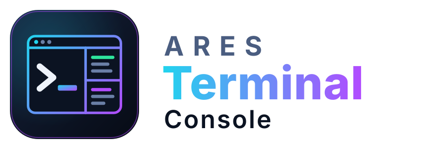

# ARES Terminal Console: Executive Summary

Version 2.3.0 · 16 November 2026 · Authored by Alfredo Nacino · Part of the ARES Application Suite

| Where | Address |
|---|---|
| **Downloads (signed)** | https://aresrepo.cybercontrol.tech |
| **Docker image** | `docker.cybercontrol.tech/ares/terminal-console` |
| **Listed on** | https://ares-suite.nacino.net |

Related documents: [Executive Summary](EXECUTIVE-SUMMARY.md) · [Executive Presentation](EXECUTIVE-PRESENTATION.md) · [Architecture](ARCHITECTURE.md) and its drawn [blueprint](blueprint.html) · [Application Description](DESCRIPTION.md).

## What it is

ARES Terminal Console is the terminal for the people who run our servers.
It has split panes and tabs, like tmux, and it adds what a plain terminal
does not have:

- **A record of the work.** Every connection opened and every command sent is
  kept, with the time, the pane and the server. Passwords are never written
  down.
- **Broadcast.** One keystroke can go to every pane in a tab, for changes that
  have to land on several machines at once. The screen turns amber while it is
  on, so nobody forgets.
- **Sessions that survive.** Closing the window, losing wifi or suspending the
  laptop does not stop a running command. Reopening picks it up where it was.
- **Seven server tools** on any SSH pane: health and processes, performance
  analysis, log analysis, AI log analysis, packages and technologies, a
  vulnerability scan, and a per-server history. They come from ARES Ultimate
  Console and TractorBeam, and they **install nothing on the server and change
  nothing**.
- **An assistant that suggests but never acts.** You ask in plain English
  ("what is listening on port 8443?"); Claude answers with the command. The
  command is placed at the prompt, and a person reads it and presses Enter.

## Where it runs

| | |
|---|---|
| **Desktop** | Linux (.deb, Arch package, tarball), macOS (Apple silicon), Windows (installer or portable zip) |
| **Docker** | `docker.cybercontrol.tech/ares/terminal-console`, used from a browser |
| **ApexBuild** | as the `terminal` module of the suite shell |

Releases are signed and published to **ARES Repository**
(<https://aresrepo.cybercontrol.tech>). The signed manifest there is what
proves a download is genuine.

## Why it matters

- **Fewer mistakes on production.** The AI assistant cannot run anything, by
  design: it has no tools and no permission to use any. Broadcast is shown in
  amber for as long as it is on. Stopping a process takes two clicks.
- **Faster diagnosis.** A slow or failing server can be checked from the pane
  already logged in to it, in seconds, without copying scripts or opening a
  second tool. The AI explanation of logs names the likely cause and the first
  command to run.
- **No new credentials.** The server tools reuse the login already typed into
  the pane (OpenSSH connection sharing). A password, one-time code or hardware
  key is asked for once.
- **Security exposure is assessed in place.** The vulnerability scan lists
  pending security updates and known CVEs (looked up on OSV.dev) for the server
  on screen.
- **Accountability.** The command record and the per-server history show what
  was run, where and when.
- **Works when things are broken.** From source it needs Python and nothing
  else: no packages, no build step, no network. A terminal is what people reach
  for when a machine is already in trouble.

## Data and privacy

- History, commands and server reports stay on the operator's computer, in its
  data folder. Nothing is sent to a central service.
- Before anything goes to Claude or OSV.dev, the tool shows exactly what will
  be sent, with secrets replaced by `***` and no server address or identity.
  It is sent only when the operator presses **Send**.
- The assistant uses the operator's own Claude subscription through Claude
  Code. There is no API key to store in the app.
- The desktop app and the Docker image always require an access token, so no
  other user of a machine or network can open a shell through it.

## Status

| | |
|---|---|
| **Current release** | 2.3.0 — Linux desktop app in a native Qt window |
| **Recent** | 2.2.x — server tools for SSH and local panes, tabs, command record, Servers list |
| **Platforms** | Linux and Windows fully supported; macOS builds are unsigned for now (first launch is right-click → Open) |

## Decisions and open items

1. **macOS signing.** An Apple Developer ID would remove the right-click step
   on first launch.
2. **Windows multiplexing.** Windows' OpenSSH cannot share a connection, so
   there the server tools need an SSH key or agent. This is a platform limit.
3. **Network use of the Docker image.** It requires a token, but a token is a
   shared secret, not a personal login. Outside a private network it must sit
   behind TLS; per-user sign-in is available only under ApexBuild.
