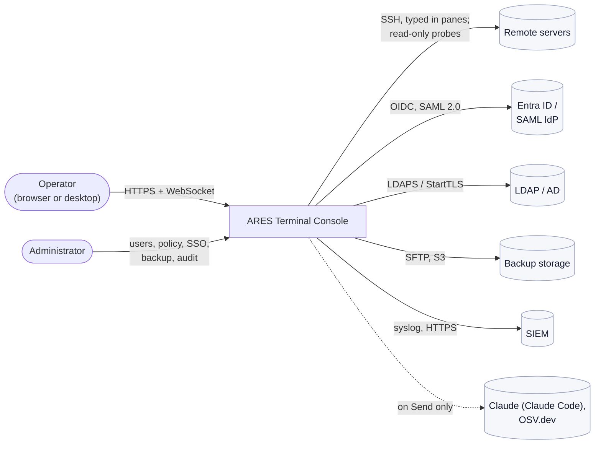
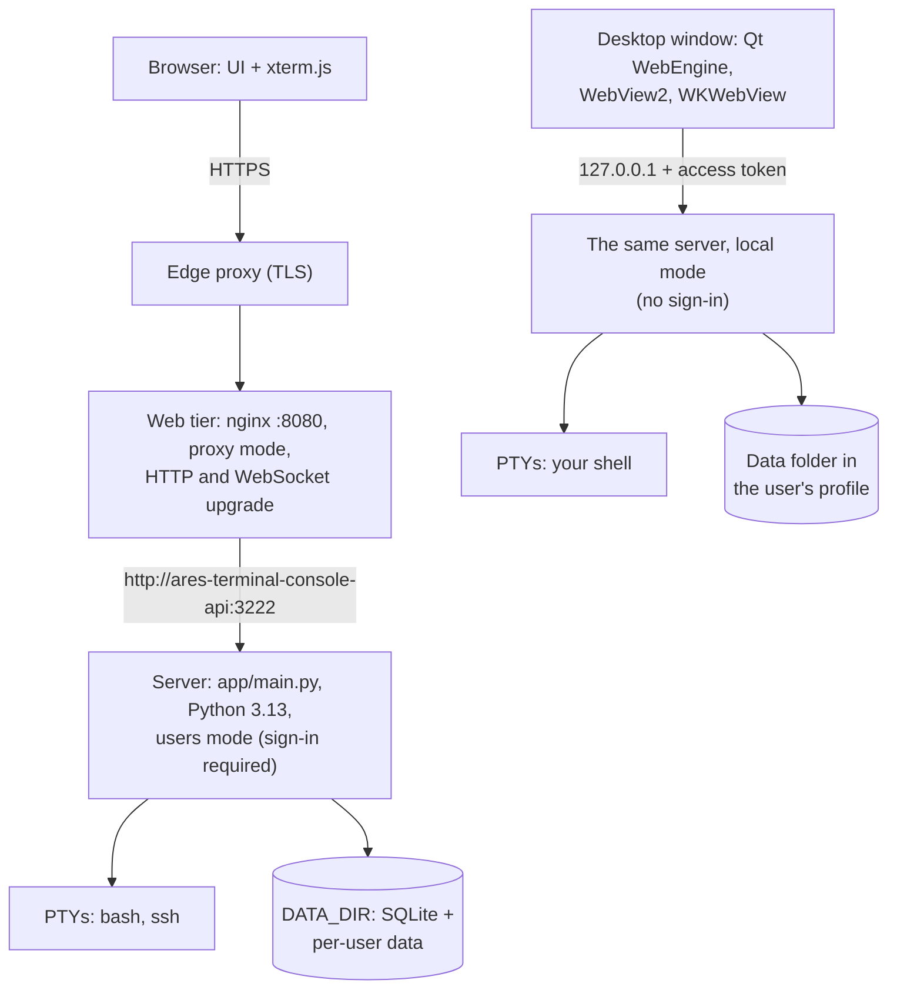
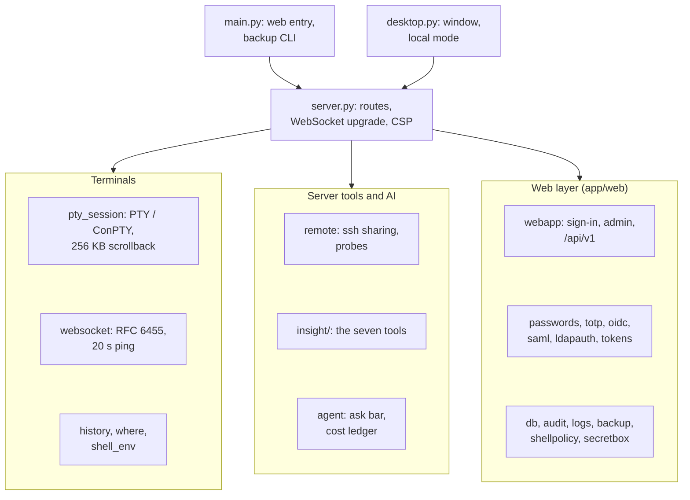
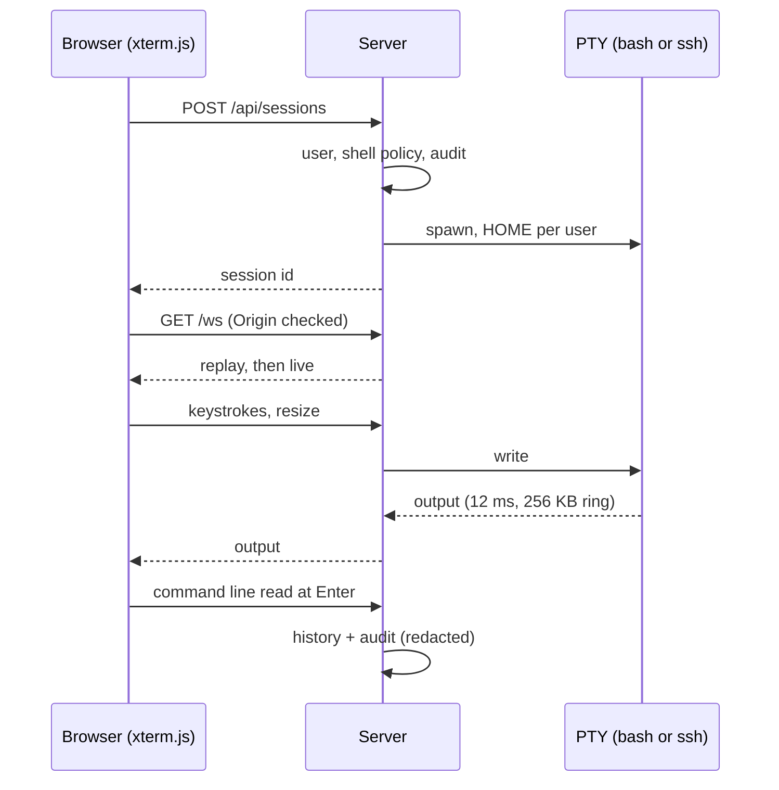
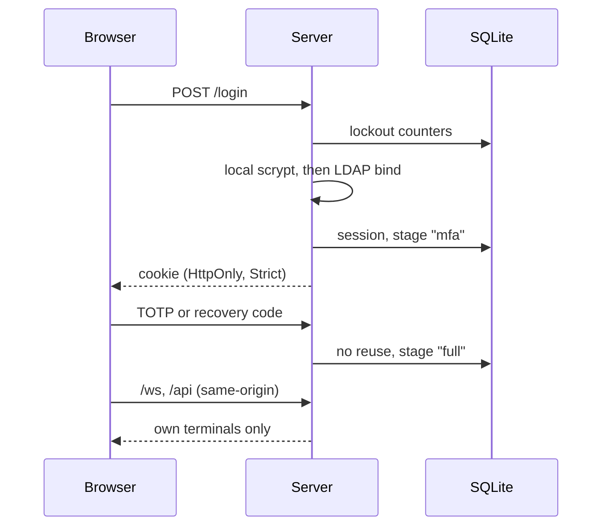
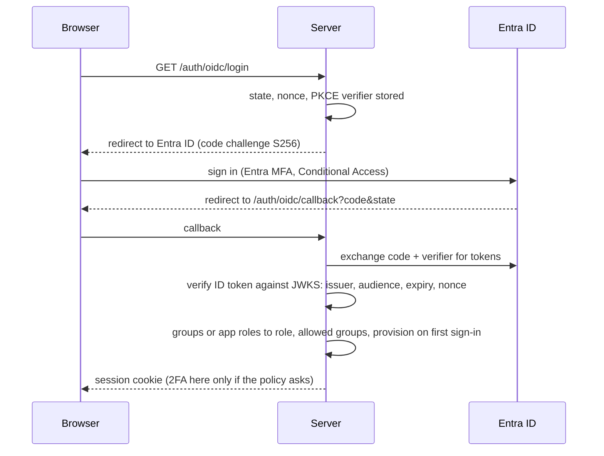
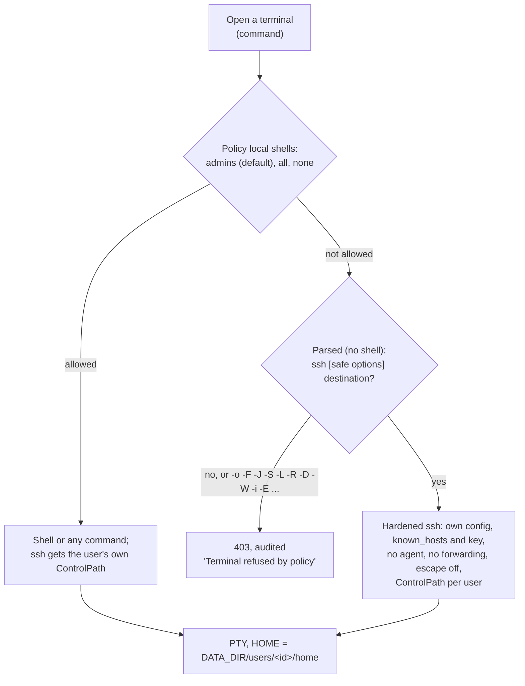
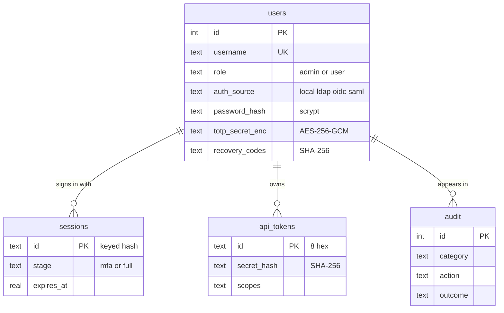
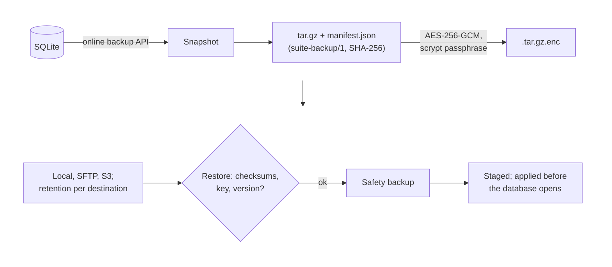
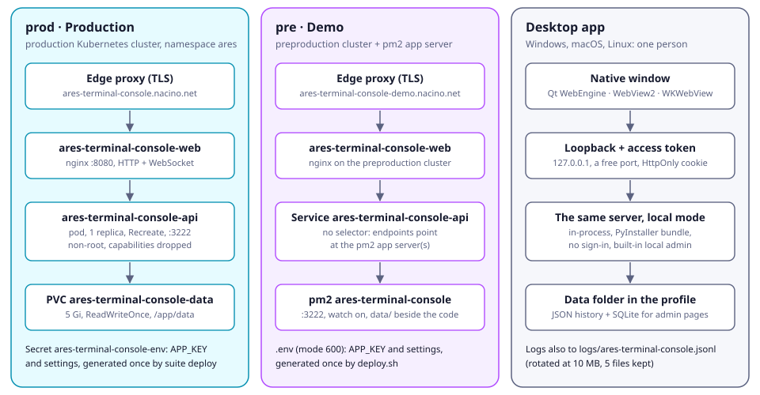

# ARES Terminal Console: Architecture

This document explains how ARES Terminal Console 2.4 is built and why: its parts, how a keystroke and a
sign-in flow through them, where data lives, how it is secured and how it runs in each environment. The
Technical Blueprint holds the detailed drawings and exact values; `docs/ARCHITECTURE.md` in the repository
is the developer's quick reference.

## Purpose and scope

The application gives operators split-pane terminals with tabs, broadcast and a record of their work. It must:

- run as a shared **web edition** (`prod`, `pre`, Docker) with sign-in, 2FA, SSO, roles and audit, **and**
  as a **desktop app** without sign-in, from one codebase and one user interface;
- keep a terminal running when its window or network goes away, and replay its output on return;
- keep web users apart: their terminals, history and SSH identity are their own, and a shell on the web
  server itself is a privilege;
- start on a machine in trouble: the terminal core is the Python standard library only.

Out of scope: hosting the servers people connect to, privileged access management (password vaulting,
session recording of the screen), and running commands on the operator's behalf (the AI is advisory).

## System context

All connections to outside systems are outbound. Remote servers are reached with the `ssh` that the
operator types; the identity providers redirect the browser back to the application. Nothing is sent to
Claude or OSV.dev without a preview and the operator's click.

## Building blocks

- **Web tier.** `nginx-unprivileged` forwarding every request, including WebSocket upgrades, to the
  server, with `X-Forwarded-For` and `X-Forwarded-Proto: https`, a one-hour idle timeout for terminal
  sockets, no buffering, and uploads up to 4 GB (backup archives to restore). The same image runs in
  every environment and has no secrets.
- **Server.** One process (`ThreadingHTTPServer`, one thread per request and a thread pair per attached
  WebSocket). It renders its own UI, serves the JSON API and the WebSocket `/ws`, owns every PTY, and in
  the web edition runs sign-in, the admin pages and `/api/v1/`. `GET /healthz` answers when it is ready.
- **Desktop app.** The same server frozen with PyInstaller, started in-process on `127.0.0.1` on a free
  port with a random access token, shown in a native window. A second launch opens another window onto
  the first copy's server instead of starting a second one.

## Software components

| Module | Responsibility |
|---|---|
| `server.py` | HTTP routes, the WebSocket upgrade, the terminal API, ownership checks, security headers and CSP |
| `pty_session.py`, `websocket.py` | PTY (POSIX) or ConPTY (Windows), 256 KB scrollback, output coalesced for 12 ms; RFC 6455 framing, 4 MB frame limit, 20 s ping |
| `history.py`, `where.py`, `shell_env.py` | connections, commands and servers with redaction; host, IP and directory of a pane; `LS_COLORS` and the `ls` / `ssh` wrappers |
| `remote.py`, `insight/` | OpenSSH connection sharing for SSH panes; the seven read-only tools and machine identity |
| `agent.py` | the ask bar on the Claude Agent SDK with no tools and no permissions; the cost ledger |
| `web/webapp.py` | `/login`, `/auth/*`, `/account`, `/admin`, `/api/v1/*`, `/saml/*`, `/auth/oidc/*`; policy and request identity |
| `web/passwords.py`, `web/totp.py`, `web/tokens.py` | scrypt passwords and policy; RFC 6238 TOTP and recovery codes; `ares_<id>_<secret>` API tokens |
| `web/oidc.py`, `web/saml.py`, `web/ldapauth.py` | Entra ID / OpenID Connect, SAML 2.0 service provider, LDAP / Active Directory |
| `web/shellpolicy.py` | who may open a local shell; the validated, pinned `ssh` for everyone else; command redaction for the audit log |
| `web/db.py`, `web/audit.py`, `web/logs.py` | SQLite in WAL mode; audit and activity; ECS JSON logs and SIEM forwarding |
| `web/backup.py`, `web/secretbox.py` | `suite-backup/1` archives, local / SFTP / S3, schedule and restore; AES-256-GCM sealing under keys derived from `APP_KEY` |

## A terminal session

The PTY belongs to the server, not to the socket. When the socket drops, the listener is removed and the
process keeps running; a new socket replays the scrollback and streams again. The server pings every idle
socket every 20 seconds so proxies keep it open. In the web edition a socket is authorised at the
handshake, may attach only to a session its own user opened, and is registered against the sign-in
session that opened it, so signing out, disabling the user or a password reset closes it at once.

## Authentication

SAML 2.0 follows the same pattern: a redirect-binding request out, a signed POST to `/saml/acs` in, with
the signature, audience, recipient, `InResponseTo`, validity window and a one-time assertion ID checked.
LDAP is a service bind, an escaped search for the user and a bind as that user; an empty password is
always refused. API clients skip the browser entirely: `Authorization: Bearer ares_<id>_<secret>` is
looked up by id, compared as SHA-256 in constant time, and limited by its scopes and its owner's role.

## Shell policy and SSH isolation

Every web shell runs as the server's one service account, so the policy decides who gets one.

- **Allowed options** for a user without local shells: the flags `-4 -6 -a -A -C -g -k -K -q -s -t -T -v -V -x -X -y -Y`
  and `-b -B -c -l -m -p -P -Q` with a value. Everything else is refused before anything runs.
- **Pinned identity.** The hardened command forces `-F <home>/.ssh/config`, `-e none`, `IdentityAgent=none`,
  `IdentitiesOnly=yes`, the user's own `IdentityFile` and `UserKnownHostsFile`, `PermitLocalCommand=no`,
  `ClearAllForwardings=yes`, no agent or X11 forwarding, and removes `SSH_AUTH_SOCK`. Options given first
  win in ssh, so the user cannot override them.
- **Per-user connection sharing.** The ControlMaster socket directory is per user (mode 700), so one
  user's authenticated connection is never reused by another user's `ssh`. The server tools ride on the
  same per-user sockets and, without local shells, work on SSH panes only.
- **Command audit.** Every command line sent is recorded with the user, terminal, connection and address,
  after `redact()` replaces the values of password, secret, token and key arguments, credentials in URLs,
  `-u user:pass` and secret-looking environment assignments with `****` (at most 1,000 characters).

## Server tools

A pane started with `ssh` gets OpenSSH multiplexing (`ControlMaster=auto`, `ControlPersist=60`); local
panes get an `ssh` wrapper that adds it for interactive logins only. Each tool is a read-only POSIX
script fed to `sh -s` over a new channel of that connection, so the login is typed once, in the pane, and
nothing is copied to or left on the server. Without a master (Windows, or a dropped login) a probe
connects on its own with `BatchMode=yes`. A server's identity is `/etc/machine-id` (or equivalents), else
its host key fingerprint, and its history is filed under it.

## Data

Everything lives under one directory, `DATA_DIR`: the PVC `ares-terminal-console-data` in `prod`,
`data/` beside the code under pm2 in `pre`, `/app/data` in Docker, and the profile's data folder on the
desktop.

| Path | Content |
|---|---|
| `ares-terminal-console.db` | SQLite (WAL): users, sign-in sessions, API tokens, settings (policy, SSO, backup, log destinations), audit, activity, SSO request state, login failures |
| `users/<id>/` | per web user: `history.json`, `servers.json`, `agent-costs.json`, and the terminal `home/` with `.ssh/config`, `known_hosts` and any keys the user created |
| `history.json`, `servers.json`, `agent-costs.json` | the same for the desktop's one user |
| `.app_key` | `APP_KEY` when the environment does not supply it |
| `backups/` | the local backup destination |
| `bin/` | the colour and `ssh` wrappers, rebuilt at start |
| `logs/ares-terminal-console.jsonl` | the rotated JSON log (desktop) |
| `initial-admin-password.txt` | the one-time `aresadmin` password (mode 600), removed after first use and never backed up |

The `activity` table (method, path template, status, duration) sits beside `audit`; `settings` holds
policy, SSO, backup and log destination configuration as JSON with secrets sealed.

Terminal history stays in small JSON files per user because it is append-mostly and private to one user;
users, sessions, tokens and the audit log need queries, transactions and a consistent online backup, so
they are in SQLite.

## Backup and restore

The archive `ares-terminal-console-backup-<YYYYMMDDTHHMMSSZ>.tar.gz[.enc]` holds the database snapshot,
the users' data folders and the key file. The passphrase is never in a backup and is required for SFTP
and S3. A restore is staged and swapped in at the next start, before anything opens the data folder; a
fresh install keeps its own `APP_KEY` and re-encrypts the restored secrets with it. The schedule runs in
one replica under a database lease; failures go to the audit log, and `/healthz` ignores backup state.
The CLI `python app/main.py backup create | list | restore | prune` works when the server cannot start.

## Logs and observability

App, audit and activity events are one ECS-compatible JSON object per line (datasets
`ares-terminal-console.app|audit|activity`) on stdout, and on the desktop also in the rotated
`logs/ares-terminal-console.jsonl`. Forwarding destinations (syslog RFC 5424 over UDP, TCP or TLS; HTTPS
NDJSON batches with a custom auth header) read audit and activity from a database cursor, so they are
delivered at least once and catch up after an outage; app events use a bounded queue with drop counters.
Nothing blocks a request. `GET /healthz` is the readiness and liveness probe; `GET /healthz/pingmora`
gives APEX Pingmora a `suite-health/1` summary, with details for a `read` token.

## Security

| Threat | Control |
|---|---|
| Anyone on the internet reaching a shell | Sign-in for everything except `/healthz`, `/healthz/pingmora` (summary) and the sign-in and SSO endpoints; TOTP 2FA required by default; lockout per username and per address |
| Stolen session cookie | 256-bit random value, only a keyed hash stored; `HttpOnly`, `SameSite=Strict`, `__Host-` and `Secure` exactly when TLS is on; idle (120 min) and absolute (12 h) expiry |
| Cross-site requests and WebSockets | `Origin` / `Sec-Fetch-Site` same-origin on every state-changing request and on the WebSocket handshake |
| Forged SSO response | OIDC: PKCE, state, nonce, JWKS signature, issuer, audience; SAML: signature required, audience, recipient, `InResponseTo`, one-time assertion IDs |
| One user reaching another's terminals | Sessions have an owner; list, attach, kill and tools check it; per-user data, home and ControlMaster sockets |
| A user getting a shell on the web server | *Local shells* policy (administrators by default); a parsed, hardened `ssh` for everyone else |
| Secrets in logs or history | Unechoed input never recorded; command lines redacted; tokens, passwords, keys, cookies and bodies never logged |
| Leaked API token | SHA-256 at rest, shown once, scoped, never above the owner's role, expiring, revocable; failures rate-limited and audited by id |
| Stored credentials | 2FA secrets, LDAP bind password, OIDC client secret, backup and log credentials sealed with AES-256-GCM under HKDF keys from `APP_KEY` |
| Injected script, clickjacking | CSP `script-src 'self'`, no inline scripts, `frame-ancestors 'self'`, `nosniff`, `Referrer-Policy: no-referrer`, `Cache-Control: no-store` |
| Container escape | Non-root (uid 10001), all capabilities dropped, RuntimeDefault seccomp, no privilege escalation |
| The AI running a command | The agent has no tools and no permissions; INSERT never sends a newline; previews before anything is sent |
| Desktop: another local user using the port | Loopback only, plus a random access token exchanged once for an HttpOnly cookie |

## Deployment

- **`prod`**: both tiers on the production Kubernetes cluster, namespace `ares`. The server is the
  Deployment `ares-terminal-console-api`, one replica with the `Recreate` strategy (the volume is
  ReadWriteOnce), requests 100m CPU and 256 Mi memory, limit 1 Gi, and probes on `/healthz`.
- **`pre`**: the web tier on the preproduction cluster; the server runs under pm2 on the preproduction
  app server(s), with `watch: true` and every runtime-written path (data, logs, database files, `.env`)
  in `ignore_watch`, so a write never restarts the server and drops the terminals. The Service
  `ares-terminal-console-api` has no selector there; its endpoints point at the app server(s).
- **Manifests** in `k8s/base` and `k8s/overlays/{pre,prod}` carry no namespace, registry, host or node;
  `suite deploy <env>` injects them. Secrets (`APP_KEY`, optional `ARES_ADMIN_PASSWORD`) are generated
  once on the first deploy: the Secret `ares-terminal-console-env` in `prod`, the `.env` (mode 600) in `pre`.
- **Release**: `suite release` tags `v<version>`, GitLab CI builds and pushes the images
  `docker.cybercontrol.tech/ares/ares-terminal-console` and `…-web`, GitHub Actions builds the desktop
  installers on Linux, Windows and macOS runners, and the signed installers go to the ARES Repository.

## Quality attributes

| Attribute | Approach |
|---|---|
| Resilience of work | Terminals outlive their socket; 256 KB replay; 20 s pings; anti-idle; the WebSocket proxy timeout is one hour |
| Responsiveness | Output coalesced for 12 ms; one thread pair per socket; no second hop between socket and PTY |
| Availability | One replica; `/healthz` probes restart a stuck pod; a restart ends running terminals but keeps all data |
| Recoverability | Encrypted `suite-backup/1` archives to local, SFTP and S3 on a schedule; restore from UI, first-run screen or CLI |
| Portability | The same code under Kubernetes, pm2, Docker and the desktop; only `DATA_DIR`, the port and the sign-in mode differ |
| Observability | ECS JSON logs, audit and activity in the database, SIEM forwarding, Pingmora health |
| Minimal dependencies | Terminal core on the standard library; every third-party import is lazy and costs only its feature |

## Decisions

| Decision | Why |
|---|---|
| Sign-in in the server, not a gateway in front | One process: a WebSocket is authorised where the PTY lives, with no second hop for every keystroke |
| No sign-in on the desktop | It is one person's terminal on their own computer; a login would protect nothing the OS account does not |
| Local shells for administrators only (web) | Every web shell is the same service account; SSH to other servers carries the user's own credentials |
| Hardened `ssh` instead of OS users per person | Separation without root, user accounts or containers per user; the limit is stated plainly |
| JSON files for terminal data, SQLite for the web layer | History stays small and per user; users, tokens and audit need queries, transactions and online backup |
| One server replica | Terminals are processes of one server; SQLite and a ReadWriteOnce volume |
| `Ctrl+Shift+…` keys, not a prefix key | A prefix must be taken before the terminal sees it, which breaks the program that needed it |
| Reuse the pane's SSH connection for the tools | A second login would prompt again, from a process with no terminal to prompt in |
| Advisory AI | The operator is there to read the command before it runs |
| The server renders its own UI | The web tier stays a plain proxy, identical in every environment |

## Risks and constraints

- **Shared service account.** Web users are separated by the application, not by the operating system.
  An administrator's local shell can read everything the service account can, including `DATA_DIR`.
- **Network reach.** A pane reaches whatever the server or pod reaches; there is no network policy in the
  committed manifests. Restrict it in `prod` if needed.
- **Single replica.** A deploy or restart ends every running terminal; there is no session hand-over.
- **Scrollback is in memory** (256 KB per session) and is not persisted or backed up.
- **No screen recording.** The audit log holds the command lines read off the screen at Enter, not a
  recording of the session's screen.
- **The AI assistant** is not available in the standard web image (no Claude Code CLI or Agent SDK in it).
- **macOS builds are unsigned**; Windows' OpenSSH cannot share connections, so the tools need a key or agent there.
