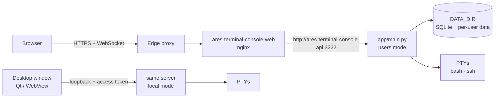
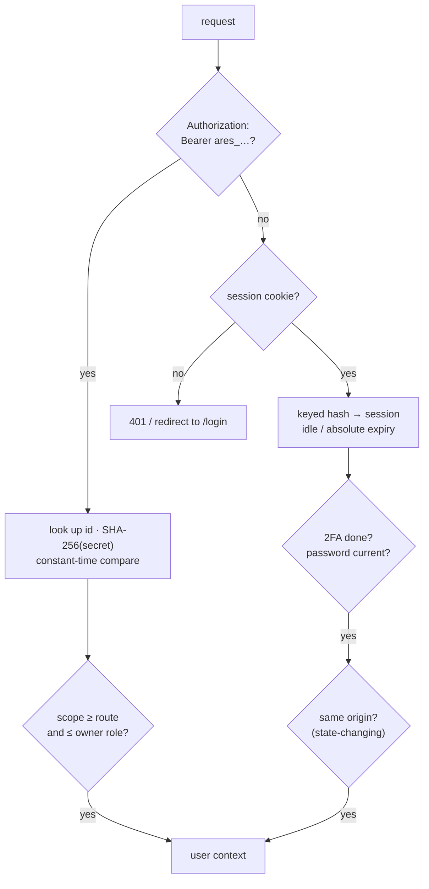
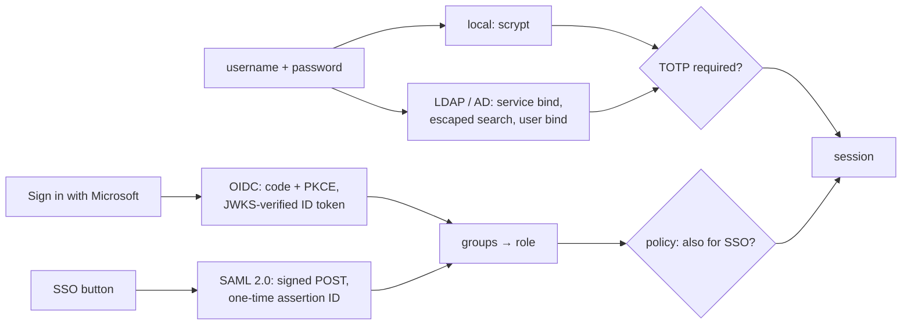
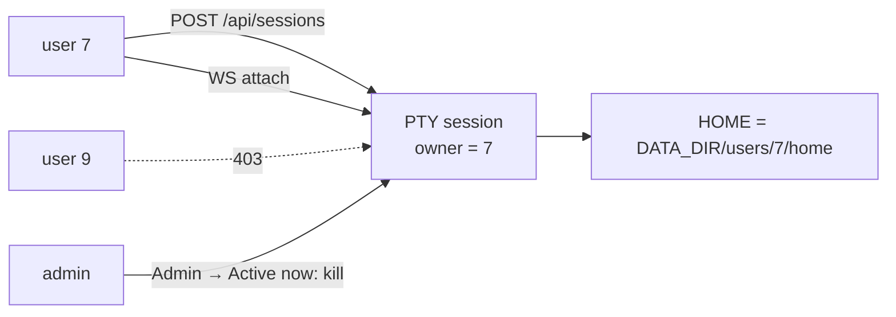
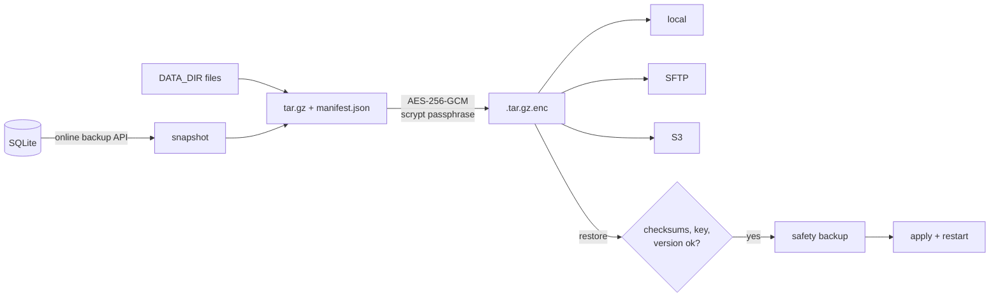
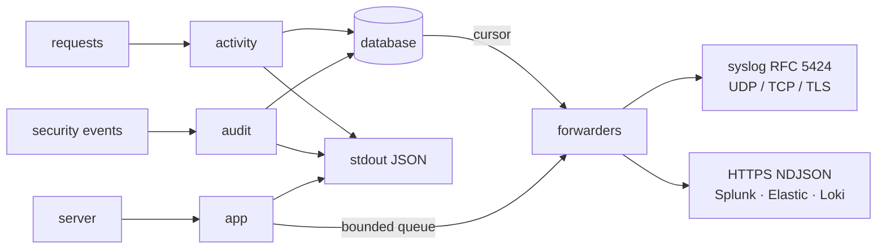
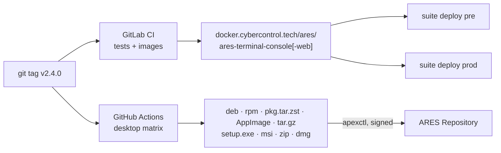

# ARES Terminal Console: Technical Blueprint

This blueprint is the engineering drawing set for ARES Terminal Console 2.4: one sheet per concern, each with the diagram and the rules an implementer or reviewer needs. The Architecture document explains *why*; these sheets say *exactly how*.

## Runtime topology

One server process owns every terminal. In `prod` it is a single Kubernetes pod with a persistent volume; in `pre` it is a pm2 process on the preproduction app server behind the same nginx web tier. The desktop app runs the same server on loopback, without sign-in.

| Tier | `prod` | `pre` | Desktop |
|---|---|---|---|
| Web | nginx Deployment, production cluster | nginx Deployment, preproduction cluster | none |
| Server | Deployment `ares-terminal-console-api`, 1 replica, `Recreate` | pm2 `ares-terminal-console`, watch on | in-process |
| State | PVC `ares-terminal-console-data`, 5 Gi | `data/` beside the code | the user's profile |
| Sign-in | required | required | none |

## Request authentication

Every request is identified once, then everything it touches resolves to that user. Bearer tokens and session cookies are the only two ways in; `/healthz`, `/login` and the SSO endpoints are the only anonymous routes.

| Check | Rule |
|---|---|
| Token | `ares_<8 hex>_<43 base64url>`; skips CSRF and 2FA, never scopes; failures rate-limited per IP |
| Session | 256-bit random value; only HMAC stored; `HttpOnly`, `SameSite=Strict`, `__Host-`/`Secure` over TLS |
| CSRF | `Origin` or `Sec-Fetch-Site` must be same-origin on every non-GET and on the WebSocket handshake |
| Lockout | per username and per source address, default 8 failures in 15 minutes |

## Sign-in methods

Four sources feed one user table. Local accounts are always checked first, so the bootstrap administrator `aresadmin` works when the directory or identity provider does not.

| Source | Groups | Provisioning |
|---|---|---|
| Local | role set by an admin | created by an admin |
| LDAP | `memberOf` DNs | on first sign-in, if auto-provision |
| Entra ID | group object IDs or app roles | on first sign-in, if auto-provision |
| SAML | groups attribute | on first sign-in, if auto-provision |

## Terminal isolation

A terminal is a PTY owned by the server, tagged with its owner. A WebSocket can only attach to a session its user opened, and it is registered against the sign-in session that opened it, so signing that session out closes the socket at once.

| Policy *local shells* | Admin | User |
|---|---|---|
| `admins` (default) | any command | parsed `ssh` only; `-o -F -S -L -R -D -W -i -E -f -N -M -O` refused |
| `all` | any command | any command |
| `none` | parsed `ssh` only | parsed `ssh` only |

## Data layout

All state lives under `DATA_DIR`. The database is SQLite in WAL mode; terminal history stays in small JSON files per user.

| Path | Content |
|---|---|
| `ares-terminal-console.db` | users, sessions, tokens, settings, audit, activity, SSO request state |
| `users/<id>/` | history, servers, AI cost ledger, terminal `home/` |
| `.app_key` | `APP_KEY` when not supplied by the environment |
| `backups/` | local backup destination |
| `logs/ares-terminal-console.jsonl` | rotated JSON log (desktop) |
| `initial-admin-password.txt` | one-time `aresadmin` password, deleted after first use |

> **Note:** Sealed values (TOTP secrets, LDAP bind password, OIDC client secret, backup and log destination credentials) are AES-256-GCM under keys derived from `APP_KEY` with HKDF.

## Backup and restore

A backup is one `suite-backup/1` archive with a manifest of checksums, a consistent SQLite snapshot and the data folder. Remote and S3 copies are always encrypted.

| Rule | Value |
|---|---|
| Name | `ares-terminal-console-backup-<YYYYMMDDTHHMMSSZ>.tar.gz[.enc]` |
| Schedule | off, hourly, every N hours, daily, weekly; one replica runs it |
| Retention | days per destination; the newest backup is always kept |
| CLI | `python app/main.py backup create \| list \| restore <file\|name> \| prune` |

## Logs and SIEM

Three streams, one ECS JSON object per line. Audit and activity are delivered at least once from a database cursor; app events use a bounded queue that drops and counts rather than block a request.

| Dataset | Content |
|---|---|
| `ares-terminal-console.audit` | sign-in, 2FA, users and roles, tokens, settings, backup, terminals and commands |
| `ares-terminal-console.activity` | method, path template, status, duration, user or token id |
| `ares-terminal-console.app` | start, stop, errors |

## Release and deployment

One tag produces every artifact. Images and installers carry the version from `VERSION`.

