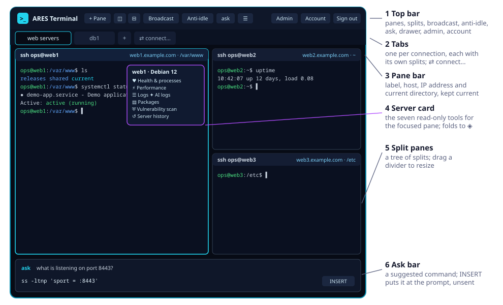
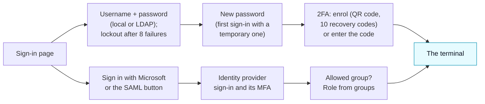
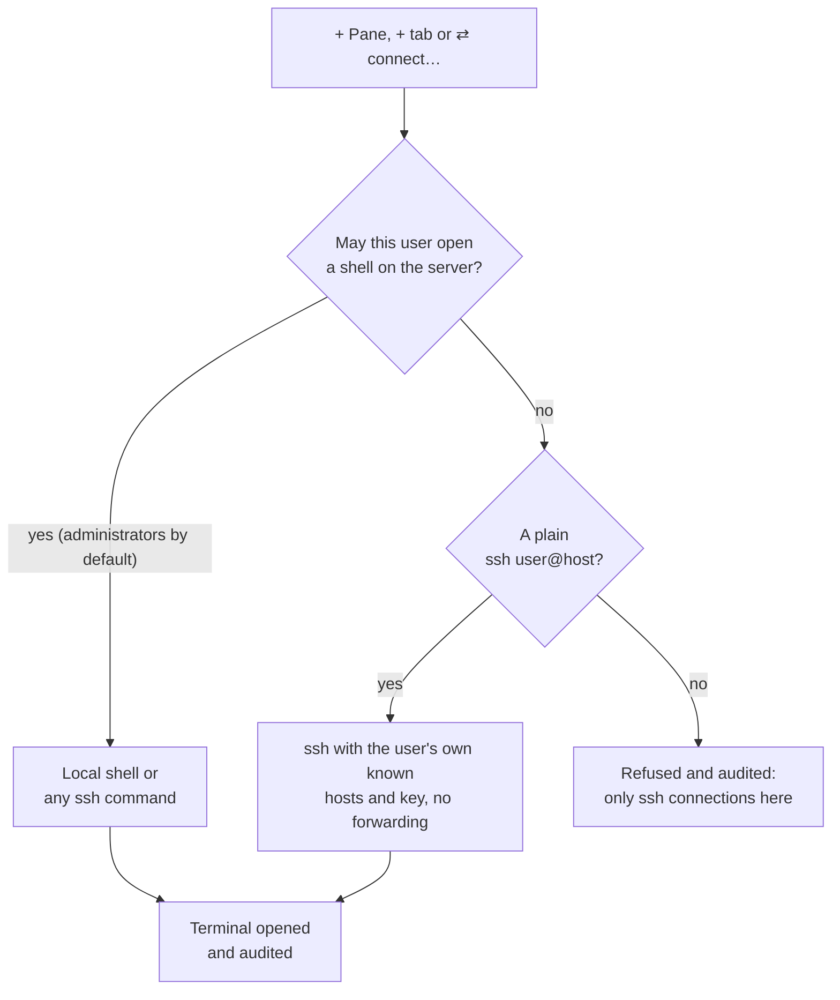
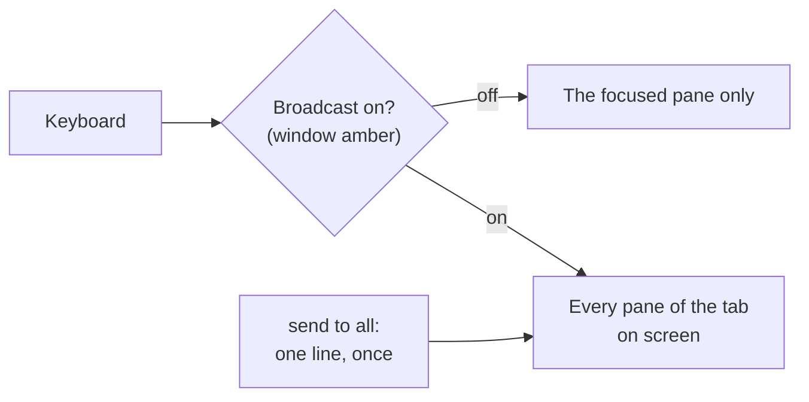
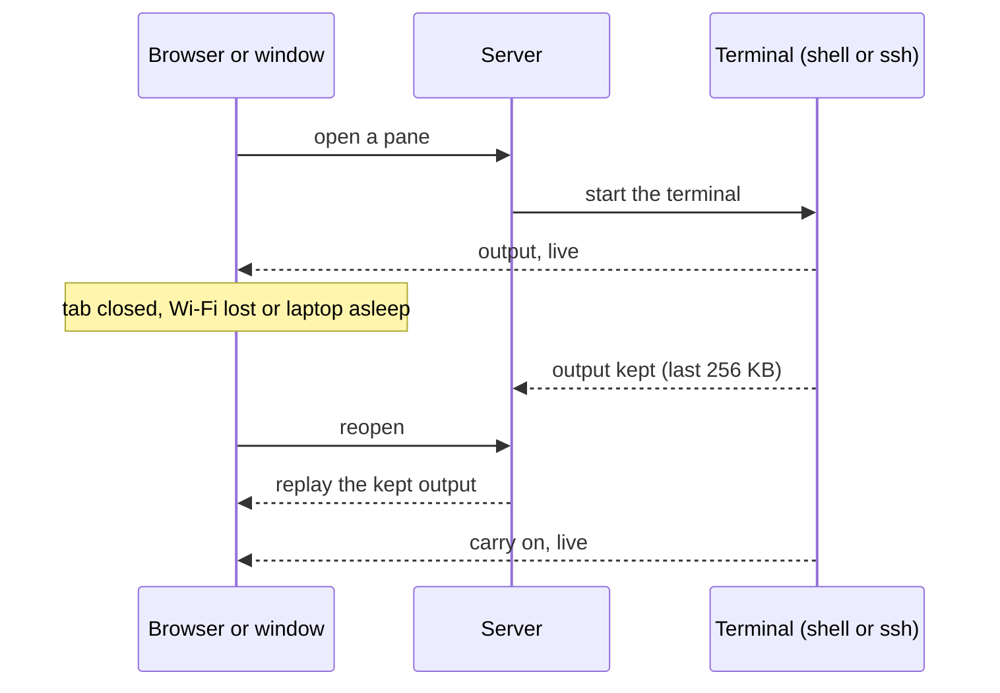
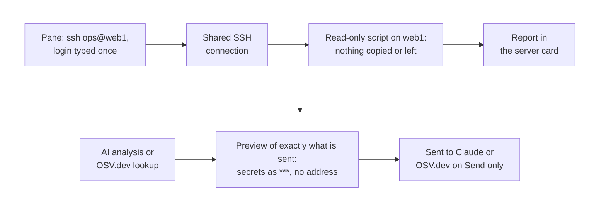
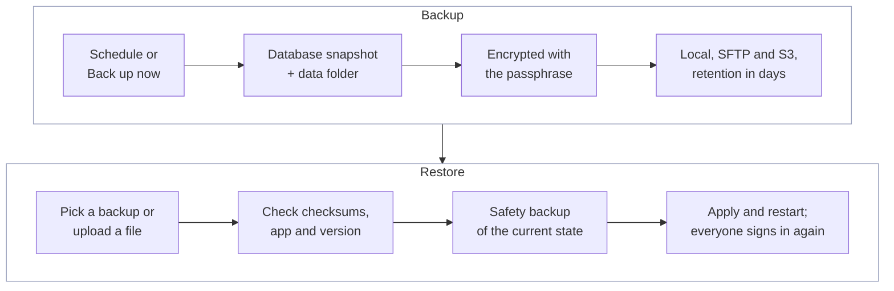

# ARES Terminal Console: Product Description

ARES Terminal Console is a terminal for people who work on servers: shells and SSH connections side by
side in split panes and tabs, typed into one at a time or all at once, with sessions that keep running
when the window closes and a record of every connection and command. It runs in a browser (the web
edition, with sign-in) and as a desktop app for Windows, macOS and Linux (no sign-in).

This document describes every feature from the user's point of view. The Architecture and the Technical
Blueprint explain how it is built.

## Who it is for

```cards
🛠️ | Administrators and operations engineers | Split the screen across servers, type into all of them at once, pick a session up after a dropped connection, and check a server without leaving the pane.
👥 | Teams sharing access | One web address, personal sign-in with 2FA or the company's single sign-on, and each person's terminals kept to themselves.
🛡️ | Security officers and auditors | Every sign-in, terminal and command line in an append-only log, exportable and forwarded to the SIEM.
```

## Two editions

| | Desktop app | Web edition |
|---|---|---|
| Where | Windows, macOS, Linux; one person's computer | a browser: https://ares-terminal-console.nacino.net (`prod`), https://ares-terminal-console-demo.nacino.net (`pre`), or a team's own Docker container |
| Sign-in | none: it opens straight into the terminal | required: local account, LDAP / Active Directory, Microsoft Entra ID or SAML 2.0, with two-factor authentication |
| Shells run as | you, on your computer | the server's service account; shells on the server are for administrators by default |
| Data | your profile's data folder | on the server, separately for each user |
| Administration page | Backup & Restore, Audit & Activity, Log forwarding, API tokens | all of those, plus Users, Active now, Policy and Single sign-on |
| AI assistant | yes, with your own Claude Code sign-in | only where Claude Code is installed on the server (not in the standard image) |

Everything else in this document (panes, tabs, broadcast, sessions, history, server tools) is the same in
both editions.

## The screen



- The **top bar** opens panes and splits, switches broadcast and anti-idle, shows the ask bar, opens the
  connections drawer (`Ctrl+Shift+H`), and in the web edition leads to **Admin**, **Account** and **Sign out**.
- Each **tab** holds its own tree of splits. Each **pane** has a bar with its label, host, IP address
  and current directory.
- The **server card** in the top-right corner of the focused pane gives the seven server tools one click
  away; ▸ folds it to a single ◈ button, and the choice is remembered.

## Signing in (web edition)



1. Open the address and choose one of the ways your administrator set up: **Sign in with Microsoft**, the
   organisation's **SSO** button (SAML), or the username and password form for a **local** or
   **directory (LDAP / Active Directory)** account.
2. A new local account signs in with a temporary password and must choose a new one: at least 12
   characters, three of lowercase, uppercase, digits and symbols, and not the username.
3. **Two-factor authentication.** If it is not set up yet, scan the QR code with any authenticator app
   (Microsoft Authenticator, Google Authenticator, 1Password, Bitwarden, FreeOTP), type the 6-digit code,
   and save the **10 recovery codes**: each works once in place of a code. From then on every sign-in
   asks for the current code.
4. Entra ID and SAML accounts use the identity provider's own MFA; the policy can ask for this app's code
   as well. Accounts from single sign-on can be created automatically on the first sign-in, with their role
   taken from their groups.

Too many wrong passwords lock the account for 15 minutes (8 failures in 15 minutes by default). A user
who has lost both phone and recovery codes asks an administrator to **reset 2FA**. Signing out does not
stop terminals: they keep running and are there at the next sign-in, until the server restarts.

## Opening terminals



| To | Do |
|---|---|
| Open a pane | **+ Pane** or `Ctrl+Shift+Enter`: a local shell, or a server to connect to when local shells are not allowed |
| Connect to a server | **⇄ connect…** (`user@host`, port), or type `ssh user@host` in a pane; it opens in a tab of its own |
| Split | `Ctrl+Shift+D` beside, `Ctrl+Shift+E` below; drag a divider to resize; closing a pane gives its space back |
| Use tabs | **+** or `Ctrl+Shift+T` for a new tab with a local shell; `Ctrl+PageUp` / `PageDown` to move; double-click to rename; closing a tab with live terminals takes a second click |
| Close a pane | `Ctrl+Shift+W` |

The layout (tabs, splits, the folded server card, anti-idle) is remembered in the browser or the desktop
app, so a reload comes back to the same screen. Every pane gets coloured `ls` output and `ll`, `la`, `lt`
shortcuts without any change to the shell's own settings (not on Windows).

In the web edition the first SSH connection to a server from an account asks to confirm its host key,
because each user keeps their own list of known hosts.

## Broadcast



- **Broadcast** (`Ctrl+Shift+S`) sends every keystroke to every pane of the tab on screen, like tmux's
  *synchronize-panes*. While it is on the window is amber, so it cannot be forgotten.
- **send to all** is the deliberate one-shot: type one line, press Enter, and it lands in every pane of
  the tab once.
- Other tabs never receive broadcast keystrokes, and the AI assistant's INSERT ignores broadcast.

## Sessions that outlive the window



- Closing the tab, losing the network or suspending the laptop does not stop a command. Reopening replays
  the last 256 KB of output and continues.
- **Running** in the connections drawer lists sessions that no pane is showing, and attaches one.
- The server checks each idle connection to the window every 20 seconds so proxies do not drop it.
  **Anti-idle** (off by default; 30 seconds to 5 minutes) sends a harmless byte to a quiet session so the
  far end does not time it out. The pane shows when it is on.
- In the desktop app, closing the window quits the app and ends its sessions, as with any terminal;
  starting it again while it runs opens another window onto the same sessions.

## Where every pane is

Each pane's bar shows the host, its IP address and the current directory, kept up to date. For a local
pane this comes from the terminal itself; for an SSH pane it is asked of the server over the pane's own
connection, with nothing to set up there. Click the directory to copy it.

## History, commands and servers

The **connections drawer** (`Ctrl+Shift+H`):

| Tab | What it lists |
|---|---|
| **Saved** | named connections for the ones used every day |
| **History** | every session opened, with start, end and exit code; name one to keep it under Saved |
| **Servers** | every SSH destination: how often and when, each session's length, the commands sent, what the server tools found; **Connect** reopens it |
| **Commands** | every command line sent to a pane, with time, pane and server; searchable; **Insert** puts it back at a prompt unsent, **Copy** copies it |
| **Running** | live sessions, including ones no pane shows |
| **Colours** | the `ls` colour legend |

**⌘** on a pane (`Ctrl+Shift+L`) lists the commands sent to that pane. A command is read off the screen as
Enter is pressed, so it is what the shell actually received after tab-completion and history recall.

> **Note:** What is never stored: input the terminal did not echo (passwords), and the values of
> `--password`, `--token`, `sshpass -p`, credentials in URLs and similar, which are blanked before anything
> is written. `ssh -p 2222` keeps its port, so a recorded connection still works.

In the web edition each user's history, saved connections and servers are their own; other users never
see them.

## Server tools

A pane connected with `ssh` shows **◈ server**; any other pane shows **◈ system**, which runs the same
tools on the machine the shell runs on. When `ssh` is typed into a local pane, the card follows that login
and returns to the local machine after `exit`.

| Tool | What it does |
|---|---|
| ♥ **Health & processes** | CPU, memory, disk, load and network every 5 seconds, top processes, and a two-click **Stop** |
| ⚡ **Performance analysis** | a quick, standard or long sampled check, with findings, charts and tables saying what is slow and why |
| ☰ **Log analysis** | errors and warnings from the journal and syslog, grouped and counted |
| ✦ **AI log analysis** | those lines explained by Claude: verdict, likely cause, first command to run |
| ▤ **Packages & technologies** | installed packages, and the runtimes, servers and databases they add up to |
| ⛨ **Vulnerability scan** | pending security updates, server issues, and known CVEs from OSV.dev |
| ↺ **Server history** | every scan and analysis of this machine, kept across sessions |



- **Nothing installed, nothing changed.** Each tool is a read-only script over the pane's own connection.
  The only action that changes anything is **Stop** on a process, which takes two clicks (and refuses the
  app's own process on a local system).
- **Consent first.** Before anything goes to Claude or OSV.dev the tool shows exactly what will be sent,
  with secrets replaced by `***` and no server address or identity, and sends only that on **Send**.
- **One history per machine.** A server reached by name, by IP or through a jump host has one history,
  filed under its machine identity.
- In the web edition, users without the right to local shells can use the tools on their SSH panes only.
  On Windows, where OpenSSH cannot share a connection, the tools need an SSH key or agent.

## The assistant

The **ask** bar (`Ctrl+Shift+A`) takes a question in plain language ("what is listening on port 8443?")
and answers with the command, a line on what it does and what to watch for.

- **It never runs anything.** **INSERT** puts the command at the focused pane's prompt without pressing
  Enter: you read it, edit it and run it yourself.
- It uses **your own Claude subscription** through the Claude Code you installed and signed in to; the
  bar shows the plan, and **Sign in with Claude** opens a pane to sign in. No key is stored in the app.
- The **$** panel shows what the asks cost per day and per model (as a measure of usage under a
  subscription). Questions are kept with their cost; answers are not.
- Without Claude Code the bar says so and everything else works. The web edition's standard image does
  not include Claude Code, so there the assistant is not available.

## Your account (web edition)

Click your name → **Account**:

- **Password**: change it (local accounts; directory and SSO passwords are changed in the directory).
- **Two-factor authentication**: see when it was set up, make new recovery codes, or turn it off when
  the policy allows.
- **API tokens**: create a token for scripts, with a name, scopes (`read`, `write`, `admin`, never above
  your role) and an expiry (90 days by default, at most one year). It is shown once; rotate or revoke it later.
- **Sign out**.

## Administration

```cards
👤 | Users | Add, change role, disable, reset password or 2FA, sign out everywhere, delete.
🟢 | Active now | Who is signed in, and every running terminal with its owner; end one.
📋 | Policy | Two-factor authentication, local shells, session length, lockout, retention.
🔑 | Single sign-on | Microsoft Entra ID, SAML 2.0 and LDAP / Active Directory, with tests.
💾 | Backup & Restore | Passphrase, destinations, schedule, retention, restore.
🧾 | Audit, logs and tokens | Audit & Activity with export, Log forwarding to the SIEM, every API token.
```

**Users.** Every account with its role, sign-in method, 2FA state, last sign-in and whether it is online.
An administrator adds users (local with a typed or generated password, or LDAP / Entra ID / SAML), changes
roles, disables (which ends the user's sessions and closes their terminal connections at once), resets a
password or 2FA, signs a user out everywhere, or deletes the account with its tokens and data (the audit
log keeps what it did). The last active administrator cannot be demoted, disabled or deleted. The first
administrator of a new installation is **`aresadmin`**, with a one-time password that must be changed at
the first sign-in.

| Role | Can |
|---|---|
| Administrator | everything, including every Admin page and shells on the server |
| User | terminals to servers over SSH; shells on the server only when the policy allows |

**Policy.**

| Setting | Default |
|---|---|
| Two-factor authentication | required for everyone (or: administrators only, optional; optionally also for SSO accounts) |
| Local shells on the server | administrators only (or: everyone, nobody) |
| Password sign-in | everyone (or: administrators only, everyone else uses SSO) |
| Session idle / maximum length | 120 minutes / 12 hours |
| Lockout | 8 failed sign-ins in 15 minutes locks the username for 15 minutes |
| Audit / activity retention | 365 / 90 days |

**Single sign-on.** Three independent sections, any combination at once: **Microsoft Entra ID** (OpenID
Connect: tenant, client ID and secret, groups or app roles, with a **Test** button), **SAML 2.0** (paste
the identity provider's metadata URL and **Load**), and **LDAP / Active Directory** (LDAPS or StartTLS,
a read-only service account, test with a user). For each: create accounts on first sign-in, which groups
make an administrator, which groups may sign in at all, and whether the role follows the directory at
every sign-in. Local accounts are checked first, so `aresadmin` works even when the directory is down.

## Backup and restore



On **Admin → Backup & Restore** (in the desktop app: **Administration → Backup & Restore**):

1. Set a **passphrase**. It encrypts every backup (AES-256-GCM) and is required for SFTP and S3; it is
   never stored in a backup, so keep it offline.
2. Add **destinations** in any combination: local (on the server or computer), **SFTP** (host key pinned on
   first use) and **S3-compatible** storage. Each has its own retention in days; the newest backup is
   always kept.
3. Choose a **schedule**: off, hourly, every N hours, daily or weekly at a set time. **Back up now** runs
   one at once; the page shows the last result per destination, and failures go to the audit log.
4. **Restore** from the page, from **Restore from backup** on a new installation's first screen, or from
   the command line (`backup restore`), which works even when the server cannot start.

A backup holds the users, settings, audit log and every user's history and SSH known hosts. Running
terminals are live processes and are not in a backup: a restore restarts the server and ends them.

## Audit, activity and logs

- **Audit & Activity** (admin): the audit log of security events (sign-ins, 2FA, lockouts, passwords,
  users and roles, tokens, settings, backups, terminals opened and closed, commands sent, with secrets
  blanked) and the activity log of every state-changing request and API call. Filters by time, user,
  action, outcome and path; export to CSV or JSON. Entries cannot be edited or deleted; they leave only
  by retention.
- **Log forwarding** (admin): send audit, activity and application events to a SIEM over syslog (UDP, TCP
  or TLS) or HTTPS (Splunk, Elastic, Graylog, Loki, Wazuh, Sentinel), with a stream filter, a minimum level
  and a **Send test event** button per destination.
- **API tokens** (admin): every user's tokens, and revoke any of them.

## Keyboard shortcuts

| Keys | Action |
|---|---|
| `Ctrl+Shift+Enter` | new pane |
| `Ctrl+Shift+D` / `E` | split beside / below |
| `Ctrl+Shift+W` | close the focused pane |
| `Ctrl+Shift+S` | broadcast on / off |
| `Ctrl+Shift+T` | new tab |
| `Ctrl+PageUp` / `PageDown` | previous / next tab |
| `Ctrl+Shift+H` | connections drawer |
| `Ctrl+Shift+L` | commands sent to the focused pane |
| `Ctrl+Shift+X` | server tools for the focused pane |
| `Ctrl+Shift+A` | ask bar on / off |
| `F11` | full screen (Linux desktop) |

`Ctrl+Shift+…` keys are used instead of a tmux-style prefix key, because a prefix has to be taken before
the terminal sees it, which breaks programs that need that key.

## Platforms

| Platform | Installers | Window | Default shell |
|---|---|---|---|
| Web | any modern browser | the browser | bash, on the server |
| Windows 10 / 11 | setup `.exe` (no administrator rights), `.msi`, portable `.zip` | WebView2 | PowerShell |
| macOS 11+ | `.dmg`, `.zip`, Apple silicon and Intel | WKWebView | your login shell |
| Linux | `.deb` (Debian, Ubuntu), `.rpm` (Fedora, Red Hat, Rocky), `.pkg.tar.zst` (Arch, CachyOS), `.AppImage`, `.tar.gz` | native Qt window | your login shell |

Downloads are signed and published on the ARES Repository.

## Limits

- A restart or deploy of the web server ends every running terminal; history, users and settings are kept.
- In the web edition every shell runs as the server's one service account: users are kept apart by the
  application, not by the operating system.
- The desktop app has no sign-in and no users, by design.
- macOS builds are not yet signed with an Apple Developer ID: the first launch is right-click → Open.
- On Windows the server tools need an SSH key or agent, because Windows' OpenSSH cannot share a connection.
- The AI assistant needs Claude Code installed and signed in where the server runs.
