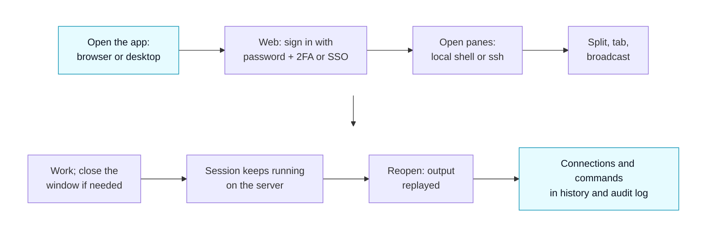
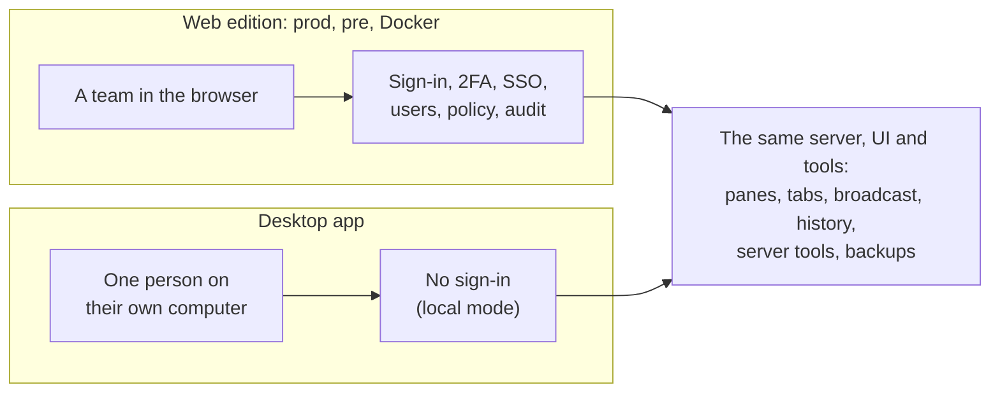

# ARES Terminal Console: Executive Summary

Split-pane terminals with tabs, broadcast, sessions that outlive the browser and a record of every connection and command. A web application with user administration, two-factor authentication and Microsoft Entra ID, SAML and LDAP single sign-on, and a login-free desktop app for Windows, macOS and Linux, with encrypted backups to local, SFTP and S3 storage.

It is the terminal of the ARES Suite, made for the people who run servers: system administrators,
operations and support engineers, and the teams that share access to the same machines. Version 2.4.0
adds the **web edition**, so a team can use it from any browser with proper sign-in, while the desktop
app stays what it was: one person's terminal on their own computer, with nothing in the way.

## At a glance

```kpi
2 | editions from one codebase: web (sign-in) and desktop (no sign-in)
4 | sign-in methods: local, LDAP / AD, Entra ID, SAML 2.0
7 | read-only server tools on any pane, nothing installed on the server
9 | desktop installer formats for Windows, macOS and Linux
```

## The problem it solves

| Pain | How the application solves it |
|---|---|
| **Many windows, many logins.** Work on several servers means a pile of terminal windows, and every extra tool asks for the login again. | Split panes and tabs in one window; the server tools reuse the login already typed into the pane, so a password or one-time code is asked for once. |
| **The same change on several machines**, typed again and again. | **Broadcast** sends every keystroke to every pane of a tab; the window turns amber while it is on, so nobody forgets. |
| **A dropped connection kills the job.** Closing the laptop or losing Wi-Fi ends a long command. | The terminal belongs to the server, not to the window: it keeps running, and reopening replays the output and carries on. |
| **"What did we run, where, and when?"** | Every connection and every command line is recorded and searchable, with passwords never written down. In the web edition it is also in the audit log, with who and from where. |
| **Shared jump hosts without control.** A team shares one machine and one account to reach servers. | The web edition gives everyone their own sign-in with 2FA or single sign-on, their own terminals and history, and keeps shells on the web server itself for administrators. |
| **Slow diagnosis.** Checking a struggling server means copying scripts or opening another tool. | Seven read-only server tools on the pane already logged in: health, performance, logs, AI log analysis, packages, vulnerability scan, history. |

## Who it is for

```cards
🛠️ | System administrators | Work on many servers side by side, push the same change to all of them, and check a server's health without leaving the pane.
👥 | Operations and support teams | Share one web address with personal sign-in, 2FA and SSO, each person with their own terminals and history.
🛡️ | Security and audit | See every sign-in, terminal and command line in an append-only log, exported to CSV / JSON or forwarded to the SIEM.
```

## How it works



One Python server owns every terminal. The browser or the desktop window shows the panes and talks to
the server over a WebSocket; the terminal process lives on the server, so it does not matter whether a
window is open. In the web edition the server first identifies the user, and everything after that
(terminals, history, server tools) belongs to that user alone.



## Key features

```cards
🪟 | Splits and tabs | Split any pane beside or below, like tmux; one tab per connection; the layout survives a reload.
📣 | Broadcast | Type into every pane of a tab at once, or send one line to all of them; amber while it is on.
♾️ | Sessions that outlive the window | Close the tab, lose the network, suspend the laptop: the command keeps running and the output is replayed.
📜 | A record of the work | Every SSH destination, session and command line, searchable; unechoed passwords are never stored.
🩺 | Server tools | Health, performance, logs, AI log analysis, packages, vulnerability scan and history, all read-only.
🔐 | Web edition for teams | Users and roles, TOTP 2FA, Entra ID, SAML and LDAP, policies, API tokens, backups, audit and SIEM.
```

## Security and privacy

- **Sign-in in front of everything** in the web edition, except the health check and the sign-in page.
  Two-factor authentication (any authenticator app) is required for every local and directory account by
  default; Entra ID and SAML accounts rely on the identity provider's own MFA unless the policy asks for both.
- **Separation between users.** Each user's terminals, history and SSH known hosts are their own. Shells
  on the web server are for administrators only by default; everyone else may open only a checked `ssh`
  connection that cannot use the server's own keys or forward ports.
- **Accountability.** Sign-ins, 2FA, user and role changes, tokens, settings, backups, every terminal
  opened and closed and every command line sent go to an append-only audit log, with secrets blanked.
- **Stored secrets encrypted** (AES-256-GCM): 2FA secrets, directory and identity provider secrets,
  backup and log destination credentials. Passwords are hashed with scrypt; API tokens are stored only as hashes.
- **Containers** run as a non-root user with all Linux capabilities dropped; no secrets in the code or the images.
- **The AI assistant cannot act.** It suggests a command and places it at the prompt without pressing
  Enter; anything sent to Claude or OSV.dev is shown first and sent only on the operator's click.

## How it is delivered

| Channel | What |
|---|---|
| Production (`prod`) | https://ares-terminal-console.nacino.net: web tier and server on the production Kubernetes cluster |
| Demo (`pre`) | https://ares-terminal-console-demo.nacino.net, for trying changes before production |
| Desktop | Windows (setup `.exe`, `.msi`, `.zip`), macOS on Apple silicon and Intel (`.dmg`, `.zip`), Linux (`.deb`, `.rpm`, `.pkg.tar.zst`, `.AppImage`, `.tar.gz`), signed, on the ARES Repository |
| Docker | `docker.cybercontrol.tech/ares/ares-terminal-console` for a team's own installation (sign-in required) |
| ARES Suite | Listed in the ARES Application Suite with this summary, the description, the architecture, the blueprint and the presentation |

## Risks and limits

> **Warning:** A terminal is remote code execution by design. In the web edition every shell runs as
> the server's one service account: users are separated by the application, not by the operating
> system. That is why shells on the web server are an administrator privilege by default.

- **One server copy.** Terminals are live processes of one server, so it runs as one replica. A restart
  or a deploy ends every running terminal (history, users and settings are kept).
- **What a pane can reach** is what the server can reach on the network; in `prod`, restrict it with a
  network policy if needed.
- **The desktop app has no sign-in** on purpose: it would protect nothing the computer's own account does not.
- **macOS builds are not signed** with an Apple Developer ID yet: the first launch needs right-click → Open.
- **Windows' OpenSSH cannot share connections**, so there the server tools need an SSH key or agent.
- **The AI assistant** needs Claude Code installed and signed in where the server runs. The web
  edition's image does not include it, so today the assistant is a desktop feature.

## Next steps (proposed)

1. **Roll out the web edition** to the first team in `prod`, with Entra ID sign-in and an S3 backup
   destination as the off-cluster copy.
2. **Forward the audit log** to the organisation's SIEM and agree the retention period.
3. **Sign the macOS builds** with an Apple Developer ID.
4. **Decide the network limits** for terminals in `prod` (which networks a pane may reach).
